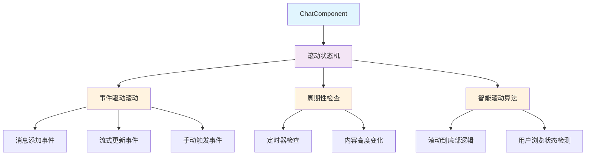
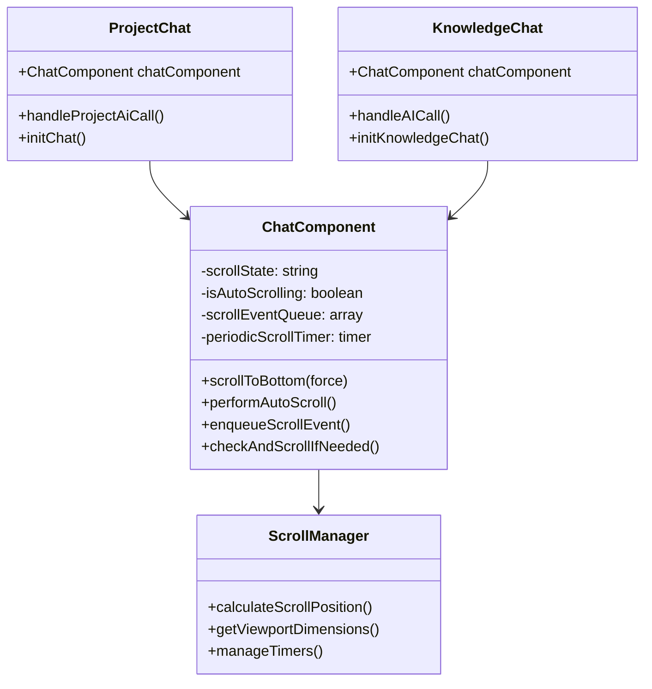
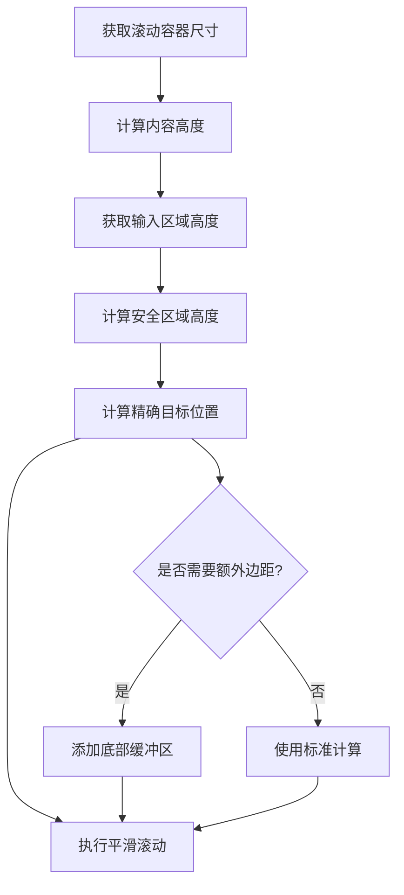
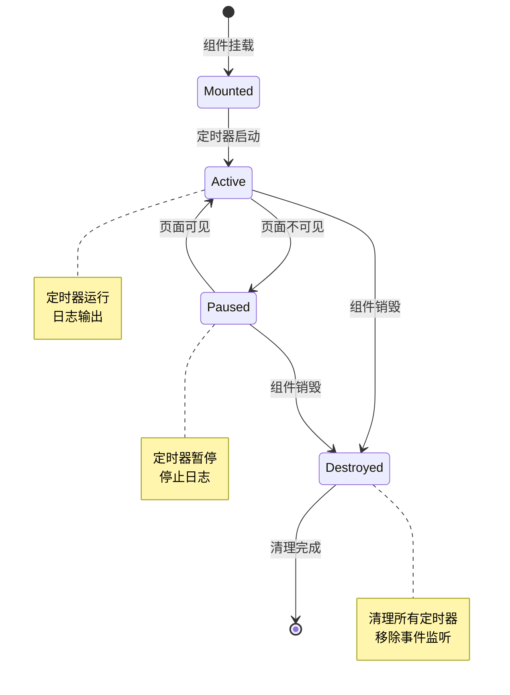
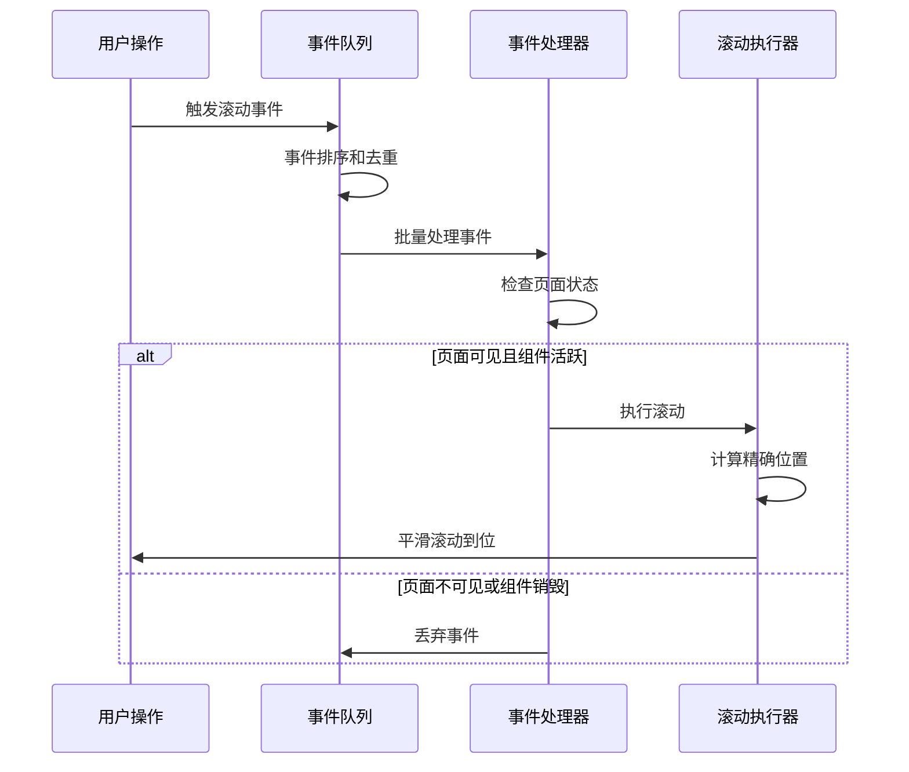

# 聊天组件滚动优化技术设计

## 1. 概述

ChatComponent是project-z中的核心交互组件，负责处理用户与AI的对话界面。当前滚动系统存在两个关键问题：滚动定位不够精确和生命周期管理不当。本设计将优化滚动机制，提升用户体验。

## 2. 技术架构

### 2.1 现有滚动系统架构



### 2.2 组件层次结构



## 3. 问题分析

### 3.1 滚动定位问题

**当前问题**：
- 消息滚动到底部时与输入框存在间距
- 计算逻辑未考虑输入区域高度和安全区域

**根因分析**：
```javascript
// 当前问题代码片段
const targetScrollTop = Math.max(0, contentHeight - scrollViewHeight)
```

**技术细节**：
- 未计算`input-area`固定高度（约200rpx + safe-area-inset-bottom）
- 未考虑不同屏幕尺寸的适配
- 缺少精确的底部边距计算

### 3.2 生命周期管理问题

**当前问题**：
- 组件销毁后定时器仍在执行
- `console.log('处理周期性检查事件')`持续输出

**根因分析**：
```javascript
// 问题源码
this.periodicScrollTimer = setInterval(() => {
  this.enqueueScrollEvent('periodic_check', false)
}, 1000)
```

**技术细节**：
- `onUnload`生命周期清理不完整
- 定时器未与组件生命周期正确绑定
- 缺少页面可见性检测

## 4. 优化方案设计

### 4.1 精确滚动定位算法

#### 4.1.1 底部间距计算策略



#### 4.1.2 滚动位置计算公式

**新的计算逻辑**：
```javascript
// 优化后的目标位置计算
const calculateTargetScrollTop = () => {
  const inputAreaHeight = 200 // rpx转px后的实际高度
  const safeAreaBottom = env('safe-area-inset-bottom') || 0
  const bottomBuffer = 40 // 额外的底部缓冲区
  
  const effectiveViewHeight = scrollViewHeight - inputAreaHeight - safeAreaBottom - bottomBuffer
  const targetScrollTop = Math.max(0, contentHeight - effectiveViewHeight)
  
  return targetScrollTop
}
```

### 4.2 生命周期管理优化

#### 4.2.1 定时器管理策略



#### 4.2.2 页面可见性检测

**实现策略**：
- 监听页面`onShow`/`onHide`事件
- 结合`uni.onAppShow`/`uni.onAppHide`全局事件
- 实现智能暂停/恢复机制

### 4.3 事件驱动滚动系统重构

#### 4.3.1 滚动事件分类

| 事件类型 | 优先级 | 触发条件 | 处理策略 |
|---------|--------|---------|---------|
| message_added | 10 | 新消息添加 | 立即滚动 |
| stream_update | 8 | 流式内容更新 | 节流滚动 |
| stream_complete | 9 | 流式完成 | 强制滚动 |
| manual_trigger | 7 | 手动触发 | 直接执行 |
| periodic_check | 1 | 周期检查 | 条件执行 |

#### 4.3.2 事件队列优化



## 5. 实现细节

### 5.1 精确滚动定位实现

#### 5.1.1 动态高度计算

**技术要点**：
- 使用`uni.createSelectorQuery()`动态获取元素尺寸
- 实时计算输入区域和安全区域高度
- 支持不同设备的自适应调整

**关键方法**：
```javascript
async calculatePreciseScrollPosition() {
  const query = uni.createSelectorQuery().in(this)
  
  // 并行查询多个元素尺寸
  const [scrollView, messageList, inputArea] = await Promise.all([
    this.queryElement(query, '#messageScrollView'),
    this.queryElement(query, '.message-list'),
    this.queryElement(query, '.input-area')
  ])
  
  // 精确计算目标位置
  const targetPosition = this.calculateOptimalScrollTop(
    scrollView, messageList, inputArea
  )
  
  return targetPosition
}
```

#### 5.1.2 平滑滚动动画

**实现策略**：
- 使用CSS3 transition实现平滑滚动
- 支持自定义缓动函数
- 提供滚动完成回调机制

### 5.2 生命周期管理实现

#### 5.2.1 定时器统一管理

**设计模式**：采用定时器管理器模式，统一控制所有定时器的生命周期。

```javascript
class TimerManager {
  constructor() {
    this.timers = new Map()
    this.isActive = true
  }
  
  createTimer(name, callback, interval) {
    if (!this.isActive) return null
    
    const timer = setInterval(() => {
      if (this.isActive) {
        callback()
      }
    }, interval)
    
    this.timers.set(name, timer)
    return timer
  }
  
  pause() {
    this.isActive = false
  }
  
  resume() {
    this.isActive = true
  }
  
  destroy() {
    this.timers.forEach(timer => clearInterval(timer))
    this.timers.clear()
    this.isActive = false
  }
}
```

#### 5.2.2 页面状态监听

**实现要点**：
- 集成`onShow`/`onHide`页面事件
- 监听应用前后台切换
- 实现组件级别的状态管理

### 5.3 性能优化策略

#### 5.3.1 滚动性能优化

**技术手段**：
- 事件节流：限制滚动事件频率
- 批量处理：合并连续的滚动请求
- 虚拟化：大量消息时的性能优化

#### 5.3.2 内存泄漏防护

**防护措施**：
- 组件销毁时清理所有定时器
- 移除事件监听器
- 清空事件队列

## 6. 测试策略

### 6.1 滚动精度测试

**测试用例**：
1. 不同屏幕尺寸下的滚动定位
2. 输入框高度变化时的自适应
3. 消息内容变化时的滚动响应

### 6.2 生命周期测试

**测试用例**：
1. 页面切换时定时器状态
2. 应用后台/前台切换
3. 组件销毁后的资源清理

### 6.3 性能测试

**测试指标**：
- 滚动响应时间
- 内存使用情况
- CPU占用率

## 7. 兼容性考虑

### 7.1 平台兼容

**支持平台**：
- 微信小程序
- H5浏览器
- App（iOS/Android）

### 7.2 设备适配

**适配策略**：
- 响应式设计
- 安全区域适配
- 不同DPI屏幕支持

## 8. 实施计划

### 8.1 开发阶段

| 阶段 | 任务 | 预计时间 |
|------|------|---------|
| 阶段1 | 精确滚动算法实现 | 2天 |
| 阶段2 | 生命周期管理优化 | 1天 |
| 阶段3 | 事件系统重构 | 2天 |
| 阶段4 | 性能优化与测试 | 2天 |

### 8.2 测试阶段

| 测试类型 | 测试内容 | 预计时间 |
|---------|---------|---------|
| 单元测试 | 滚动算法验证 | 1天 |
| 集成测试 | 组件交互测试 | 1天 |
| 性能测试 | 性能指标验证 | 1天 |
| 兼容性测试 | 多平台测试 | 2天 |

### 8.3 部署计划

**部署策略**：
- 灰度发布：优先在测试环境验证
- 分批上线：按模块逐步发布
- 监控报警：实时监控性能指标

## 9. 风险评估

### 9.1 技术风险

| 风险项 | 风险等级 | 影响 | 缓解措施 |
|--------|---------|------|---------|
| 滚动性能下降 | 中 | 用户体验 | 性能测试验证 |
| 兼容性问题 | 低 | 功能异常 | 多平台测试 |
| 内存泄漏 | 高 | 应用崩溃 | 严格的生命周期管理 |

### 9.2 业务风险

**风险控制**：
- 保持向后兼容
- 提供降级方案
- 快速回滚机制

## 10. 监控与维护

### 10.1 性能监控

**关键指标**：
- 滚动响应时间
- 内存占用趋势
- 异常错误率

### 10.2 用户反馈

**收集渠道**：
- 应用内反馈
- 用户行为分析
- 崩溃日志收集

### 10.3 持续优化

**优化方向**：
- 算法持续改进
- 新平台适配
- 用户体验提升