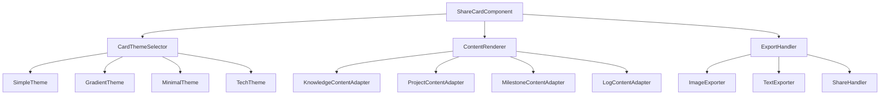
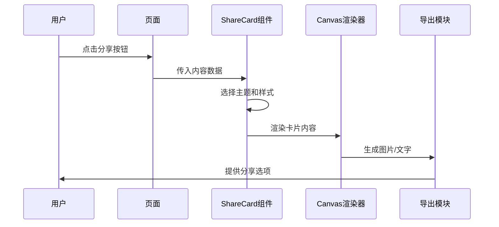
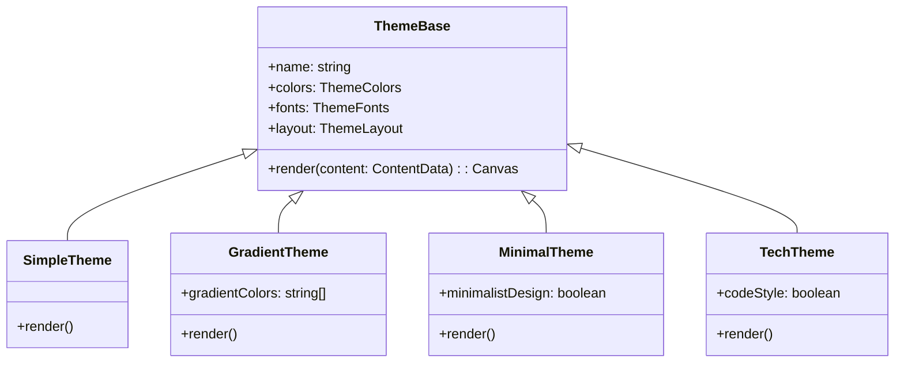

# 知识卡片分享功能设计

## 概述

设计一个通用的卡片分享组件，用于生成精美的知识卡片和项目信息卡片。该组件支持多种主题风格、内容自适应、图片和文字导出功能，能够在知识库详情页和项目详情页中集成使用。

## 架构设计

### 组件架构



### 数据流架构



## 核心组件设计

### ShareCardComponent.vue 主组件

#### 组件接口设计

```typescript
interface ShareCardProps {
  // 内容类型
  contentType: 'knowledge' | 'project' | 'milestone' | 'log' | 'analysis'
  
  // 内容数据
  contentData: {
    title: string
    content: string
    author?: string
    timestamp?: string
    tags?: string[]
    progress?: number
    extra?: any
  }
  
  // 显示配置
  visible: boolean
  defaultTheme?: string
  showBranding?: boolean
  customLogo?: string
}

interface ShareCardEvents {
  close: () => void
  share: (result: ShareResult) => void
  export: (type: 'image' | 'text', data: any) => void
}
```

#### 主题系统设计



### 内容适配器设计

#### KnowledgeContentAdapter.vue

```vue
<template>
  <view class="knowledge-card-content">
    <view class="card-header">
      <text class="title">{{ content.title }}</text>
      <view class="tags">
        <text v-for="tag in content.tags" :key="tag" class="tag">{{ tag }}</text>
      </view>
    </view>
    
    <view class="card-body">
      <text class="summary">{{ truncatedContent }}</text>
    </view>
    
    <view class="card-footer">
      <view class="meta-info">
        <text class="author">{{ content.author || '知识管理' }}</text>
        <text class="time">{{ formatTime(content.timestamp) }}</text>
      </view>
      <view class="branding" v-if="showBranding">
        <text class="app-name">Project-Z</text>
      </view>
    </view>
  </view>
</template>
```

#### ProjectContentAdapter.vue

```vue
<template>
  <view class="project-card-content">
    <!-- 项目标题区 -->
    <view class="project-header">
      <text class="project-title">{{ content.title }}</text>
      <view class="progress-section" v-if="content.progress !== undefined">
        <text class="progress-label">进度</text>
        <view class="progress-bar">
          <view class="progress-fill" :style="{ width: content.progress + '%' }"></view>
        </view>
        <text class="progress-text">{{ content.progress }}%</text>
      </view>
    </view>
    
    <!-- 内容区 -->
    <view class="project-body">
      <text class="project-content">{{ content.content }}</text>
      
      <!-- 里程碑信息 -->
      <view class="milestones" v-if="content.milestones">
        <view v-for="milestone in content.milestones.slice(0, 3)" 
              :key="milestone.id" 
              class="milestone-item">
          <view class="milestone-status" :class="milestone.status"></view>
          <text class="milestone-title">{{ milestone.title }}</text>
        </view>
      </view>
    </view>
    
    <!-- 底部信息 -->
    <view class="project-footer">
      <text class="update-time">{{ formatTime(content.timestamp) }}</text>
      <view class="branding" v-if="showBranding">
        <text class="app-name">Project-Z</text>
      </view>
    </view>
  </view>
</template>
```

### 渲染引擎设计

#### CanvasRenderer.js

```javascript
class CanvasRenderer {
  constructor(canvasId, theme) {
    this.canvasId = canvasId
    this.theme = theme
    this.canvas = null
    this.ctx = null
    this.pixelRatio = uni.getSystemInfoSync().pixelRatio
  }
  
  async init() {
    const query = uni.createSelectorQuery()
    return new Promise((resolve, reject) => {
      query.select(`#${this.canvasId}`)
        .fields({ node: true, size: true })
        .exec((res) => {
          if (res[0]) {
            this.canvas = res[0].node
            this.ctx = this.canvas.getContext('2d')
            
            // 设置画布尺寸
            const { width, height } = this.calculateCanvasSize()
            this.canvas.width = width * this.pixelRatio
            this.canvas.height = height * this.pixelRatio
            this.ctx.scale(this.pixelRatio, this.pixelRatio)
            
            resolve()
          } else {
            reject(new Error('Failed to get canvas context'))
          }
        })
    })
  }
  
  calculateCanvasSize() {
    // 根据内容计算最佳画布尺寸
    return {
      width: 750,  // 基础宽度
      height: 1000 // 基础高度，根据内容动态调整
    }
  }
  
  async renderCard(content, adaptedContent) {
    this.clearCanvas()
    
    // 根据主题渲染背景
    this.renderBackground()
    
    // 渲染内容
    await this.renderContent(adaptedContent)
    
    // 渲染装饰元素
    this.renderDecorations()
    
    return this.exportImage()
  }
  
  renderBackground() {
    const { colors, gradients } = this.theme
    
    if (gradients && gradients.length > 0) {
      // 渐变背景
      const gradient = this.ctx.createLinearGradient(0, 0, 0, this.canvas.height)
      gradients.forEach((color, index) => {
        gradient.addColorStop(index / (gradients.length - 1), color)
      })
      this.ctx.fillStyle = gradient
    } else {
      // 纯色背景
      this.ctx.fillStyle = colors.background
    }
    
    this.ctx.fillRect(0, 0, this.canvas.width, this.canvas.height)
  }
  
  async renderContent(adaptedContent) {
    const { layout, fonts } = this.theme
    let currentY = layout.padding
    
    // 渲染标题
    currentY = this.renderTitle(adaptedContent.title, currentY)
    
    // 渲染标签
    if (adaptedContent.tags && adaptedContent.tags.length > 0) {
      currentY = this.renderTags(adaptedContent.tags, currentY)
    }
    
    // 渲染主要内容
    currentY = this.renderMainContent(adaptedContent.content, currentY)
    
    // 渲染进度条（如果有）
    if (adaptedContent.progress !== undefined) {
      currentY = this.renderProgress(adaptedContent.progress, currentY)
    }
    
    // 渲染底部信息
    this.renderFooter(adaptedContent, this.canvas.height - layout.padding - 60)
  }
  
  renderTitle(title, startY) {
    const { fonts, colors } = this.theme
    
    this.ctx.font = `bold ${fonts.title.size}px ${fonts.title.family}`
    this.ctx.fillStyle = colors.title
    this.ctx.textAlign = 'center'
    
    // 处理长标题换行
    const lines = this.wrapText(title, this.canvas.width - 80, fonts.title.size)
    lines.forEach((line, index) => {
      this.ctx.fillText(line, this.canvas.width / 2, startY + (index * fonts.title.lineHeight))
    })
    
    return startY + (lines.length * fonts.title.lineHeight) + 30
  }
  
  renderTags(tags, startY) {
    const { colors, layout } = this.theme
    const tagHeight = 32
    const tagSpacing = 12
    const tagPadding = 16
    
    let currentX = layout.padding
    let currentY = startY
    
    tags.forEach(tag => {
      const tagWidth = this.ctx.measureText(tag).width + tagPadding * 2
      
      // 换行检查
      if (currentX + tagWidth > this.canvas.width - layout.padding) {
        currentX = layout.padding
        currentY += tagHeight + tagSpacing
      }
      
      // 绘制标签背景
      this.ctx.fillStyle = colors.tagBackground
      this.ctx.fillRect(currentX, currentY, tagWidth, tagHeight)
      
      // 绘制标签文字
      this.ctx.fillStyle = colors.tagText
      this.ctx.font = `14px ${this.theme.fonts.body.family}`
      this.ctx.textAlign = 'left'
      this.ctx.fillText(tag, currentX + tagPadding, currentY + 22)
      
      currentX += tagWidth + tagSpacing
    })
    
    return currentY + tagHeight + 40
  }
  
  renderMainContent(content, startY) {
    const { fonts, colors } = this.theme
    const maxHeight = 300 // 最大内容高度
    
    this.ctx.font = `${fonts.body.size}px ${fonts.body.family}`
    this.ctx.fillStyle = colors.body
    this.ctx.textAlign = 'left'
    
    const lines = this.wrapText(content, this.canvas.width - 80, fonts.body.size)
    const visibleLines = Math.floor(maxHeight / fonts.body.lineHeight)
    
    lines.slice(0, visibleLines).forEach((line, index) => {
      this.ctx.fillText(line, 40, startY + (index * fonts.body.lineHeight))
    })
    
    // 如果内容被截断，添加省略号
    if (lines.length > visibleLines) {
      const lastY = startY + ((visibleLines - 1) * fonts.body.lineHeight)
      this.ctx.fillText('...', 40, lastY)
    }
    
    return startY + (Math.min(lines.length, visibleLines) * fonts.body.lineHeight) + 40
  }
  
  renderProgress(progress, startY) {
    const { colors } = this.theme
    const progressWidth = this.canvas.width - 80
    const progressHeight = 8
    const progressX = 40
    
    // 进度条背景
    this.ctx.fillStyle = colors.progressBackground
    this.ctx.fillRect(progressX, startY, progressWidth, progressHeight)
    
    // 进度条填充
    this.ctx.fillStyle = colors.progress
    this.ctx.fillRect(progressX, startY, progressWidth * (progress / 100), progressHeight)
    
    // 进度文字
    this.ctx.font = `14px ${this.theme.fonts.body.family}`
    this.ctx.fillStyle = colors.body
    this.ctx.textAlign = 'right'
    this.ctx.fillText(`${progress}%`, this.canvas.width - 40, startY + 20)
    
    return startY + 50
  }
  
  renderFooter(content, startY) {
    const { fonts, colors } = this.theme
    
    // 时间信息
    this.ctx.font = `12px ${fonts.body.family}`
    this.ctx.fillStyle = colors.meta
    this.ctx.textAlign = 'left'
    this.ctx.fillText(content.timestamp || '', 40, startY)
    
    // 品牌信息
    if (content.showBranding) {
      this.ctx.textAlign = 'right'
      this.ctx.fillText('Project-Z', this.canvas.width - 40, startY)
    }
  }
  
  wrapText(text, maxWidth, fontSize) {
    const words = text.split('')
    const lines = []
    let currentLine = ''
    
    words.forEach(char => {
      const testLine = currentLine + char
      const metrics = this.ctx.measureText(testLine)
      
      if (metrics.width > maxWidth && currentLine !== '') {
        lines.push(currentLine)
        currentLine = char
      } else {
        currentLine = testLine
      }
    })
    
    if (currentLine) {
      lines.push(currentLine)
    }
    
    return lines
  }
  
  clearCanvas() {
    this.ctx.clearRect(0, 0, this.canvas.width, this.canvas.height)
  }
  
  exportImage() {
    return new Promise((resolve) => {
      uni.canvasToTempFilePath({
        canvasId: this.canvasId,
        canvas: this.canvas,
        success: (res) => {
          resolve(res.tempFilePath)
        },
        fail: () => {
          resolve(null)
        }
      })
    })
  }
}
```

### 主题定义

#### 主题配置文件

```javascript
// themes/index.js
export const themes = {
  simple: {
    name: '简约',
    colors: {
      background: '#FFFFFF',
      title: '#1D2129',
      body: '#4E5969',
      meta: '#86909C',
      accent: '#165DFF',
      tagBackground: '#F2F3F5',
      tagText: '#86909C',
      progress: '#165DFF',
      progressBackground: '#F2F3F5'
    },
    fonts: {
      title: {
        family: 'PingFang SC',
        size: 28,
        lineHeight: 40
      },
      body: {
        family: 'PingFang SC',
        size: 16,
        lineHeight: 24
      }
    },
    layout: {
      padding: 40,
      borderRadius: 16
    }
  },
  
  gradient: {
    name: '渐变',
    colors: {
      background: '#FFFFFF',
      title: '#FFFFFF',
      body: '#FFFFFF',
      meta: 'rgba(255,255,255,0.8)',
      accent: '#FFFFFF',
      tagBackground: 'rgba(255,255,255,0.2)',
      tagText: '#FFFFFF',
      progress: '#FFFFFF',
      progressBackground: 'rgba(255,255,255,0.3)'
    },
    gradients: ['#667eea', '#764ba2'],
    fonts: {
      title: {
        family: 'PingFang SC',
        size: 28,
        lineHeight: 40
      },
      body: {
        family: 'PingFang SC',
        size: 16,
        lineHeight: 24
      }
    },
    layout: {
      padding: 40,
      borderRadius: 16
    }
  },
  
  minimal: {
    name: '极简',
    colors: {
      background: '#F8F9FA',
      title: '#2C3E50',
      body: '#5A6C7D',
      meta: '#95A5A6',
      accent: '#3498DB',
      tagBackground: '#ECF0F1',
      tagText: '#7F8C8D',
      progress: '#3498DB',
      progressBackground: '#ECF0F1'
    },
    fonts: {
      title: {
        family: 'SF Pro Display',
        size: 26,
        lineHeight: 36
      },
      body: {
        family: 'SF Pro Text',
        size: 15,
        lineHeight: 22
      }
    },
    layout: {
      padding: 32,
      borderRadius: 12
    }
  },
  
  tech: {
    name: '科技',
    colors: {
      background: '#0D1117',
      title: '#F0F6FC',
      body: '#C9D1D9',
      meta: '#8B949E',
      accent: '#58A6FF',
      tagBackground: '#21262D',
      tagText: '#F0F6FC',
      progress: '#58A6FF',
      progressBackground: '#21262D'
    },
    fonts: {
      title: {
        family: 'SF Mono',
        size: 24,
        lineHeight: 32
      },
      body: {
        family: 'SF Mono',
        size: 14,
        lineHeight: 20
      }
    },
    layout: {
      padding: 32,
      borderRadius: 8
    }
  }
}
```

## 集成方案

### 在知识详情页集成

#### 修改 knowledge/detail.vue

```vue
<template>
  <view class="knowledge-detail-page">
    <!-- 现有内容 -->
    
    <!-- 分享卡片组件 -->
    <ShareCardComponent
      v-model:visible="showShareCard"
      content-type="knowledge"
      :content-data="shareCardData"
      @share="handleShare"
      @export="handleExport"
    />
  </view>
</template>

<script>
import ShareCardComponent from '@/components/ShareCardComponent.vue'

export default {
  components: {
    ShareCardComponent
  },
  data() {
    return {
      showShareCard: false,
      shareCardData: {}
    }
  },
  methods: {
    shareKnowledge() {
      // 准备分享数据
      this.shareCardData = {
        title: this.knowledgeData.title,
        content: this.knowledgeData.summary || this.knowledgeData.content,
        tags: this.knowledgeData.tags,
        timestamp: this.knowledgeData.updateTime,
        author: '知识管理',
        viewCount: this.knowledgeData.viewCount
      }
      this.showShareCard = true
    },
    
    handleShare(result) {
      // 处理分享结果
      if (result.type === 'image') {
        this.shareImage(result.data)
      } else if (result.type === 'text') {
        this.shareText(result.data)
      }
    },
    
    handleExport(type, data) {
      if (type === 'image') {
        // 保存图片到相册
        uni.saveImageToPhotosAlbum({
          filePath: data,
          success: () => {
            uni.showToast({
              title: '已保存到相册',
              icon: 'success'
            })
          }
        })
      }
    }
  }
}
</script>
```

### 在项目详情页集成

#### 修改 project/detail.vue

```vue
<template>
  <view class="project-detail-page">
    <!-- 现有内容 -->
    
    <!-- 分享卡片组件 -->
    <ShareCardComponent
      v-model:visible="showShareCard"
      :content-type="shareContentType"
      :content-data="shareCardData"
      @share="handleShare"
      @export="handleExport"
    />
  </view>
</template>

<script>
import ShareCardComponent from '@/components/ShareCardComponent.vue'

export default {
  components: {
    ShareCardComponent
  },
  data() {
    return {
      showShareCard: false,
      shareContentType: 'project',
      shareCardData: {}
    }
  },
  methods: {
    // 分享项目概览
    shareProject() {
      this.shareContentType = 'project'
      this.shareCardData = {
        title: this.projectTitle,
        content: this.projectGoal,
        progress: this.project.progress || 0,
        timestamp: this.project.updated_at,
        milestones: this.milestones.slice(0, 3).map(m => ({
          id: m.id,
          title: m.title,
          status: m.status
        }))
      }
      this.showShareCard = true
    },
    
    // 分享里程碑
    shareMilestone(milestone) {
      this.shareContentType = 'milestone'
      this.shareCardData = {
        title: `项目里程碑：${milestone.title}`,
        content: milestone.description || '里程碑进展顺利',
        progress: milestone.progress,
        timestamp: milestone.deadline,
        projectTitle: this.projectTitle
      }
      this.showShareCard = true
    },
    
    // 分享日志
    shareLog(log) {
      this.shareContentType = 'log'
      this.shareCardData = {
        title: `项目日志 - ${this.projectTitle}`,
        content: log.content || log.progressText || '项目进展更新',
        timestamp: log.time,
        progress: this.project.progress,
        logType: 'progress'
      }
      this.showShareCard = true
    },
    
    // 分享AI分析
    shareAnalysis(analysis) {
      this.shareContentType = 'analysis'
      this.shareCardData = {
        title: `项目AI分析 - ${this.projectTitle}`,
        content: analysis.content,
        suggestions: analysis.suggestions,
        timestamp: analysis.formattedTime,
        analysisType: this.getAnalysisTypeText(analysis.analysisType)
      }
      this.showShareCard = true
    }
  }
}
</script>
```

## 导出功能设计

### 文字导出格式

```javascript
// textExporter.js
export class TextExporter {
  static export(contentType, data) {
    switch (contentType) {
      case 'knowledge':
        return this.exportKnowledge(data)
      case 'project':
        return this.exportProject(data)
      case 'milestone':
        return this.exportMilestone(data)
      default:
        return this.exportGeneric(data)
    }
  }
  
  static exportKnowledge(data) {
    const tags = data.tags ? data.tags.map(tag => `#${tag}`).join(' ') : ''
    
    return `📚 ${data.title}

${data.content}

${tags}

📅 ${data.timestamp}
👁️ 浏览量: ${data.viewCount || 0}

---
来自 Project-Z 知识管理系统`
  }
  
  static exportProject(data) {
    const progressBar = '▓'.repeat(Math.floor(data.progress / 10)) + 
                       '░'.repeat(10 - Math.floor(data.progress / 10))
    
    return `🚀 项目：${data.title}

📋 目标：${data.content}

📊 进度：${progressBar} ${data.progress}%

🎯 关键里程碑：
${data.milestones ? data.milestones.map(m => `• ${m.title} (${m.status})`).join('\n') : ''}

🕒 更新时间：${data.timestamp}

---
来自 Project-Z 项目管理系统`
  }
  
  static exportMilestone(data) {
    return `🎯 ${data.title}

📝 ${data.content}

📊 完成进度：${data.progress}%
⏰ 截止时间：${data.timestamp}
🏷️ 所属项目：${data.projectTitle}

---
来自 Project-Z 项目管理系统`
  }
}
```

## 测试策略

### 单元测试

```javascript
// tests/ShareCardComponent.test.js
describe('ShareCardComponent', () => {
  test('should render knowledge card correctly', async () => {
    const wrapper = mount(ShareCardComponent, {
      props: {
        contentType: 'knowledge',
        contentData: {
          title: '测试知识',
          content: '测试内容',
          tags: ['标签1', '标签2']
        },
        visible: true
      }
    })
    
    await wrapper.vm.$nextTick()
    expect(wrapper.find('.knowledge-card-content').exists()).toBe(true)
  })
  
  test('should export image correctly', async () => {
    const component = new ShareCardComponent()
    const result = await component.exportImage()
    expect(result).toBeTruthy()
    expect(result.type).toBe('image')
  })
})
```

### 集成测试

```javascript
// tests/integration/share-flow.test.js
describe('Share Flow Integration', () => {
  test('knowledge detail share flow', async () => {
    const knowledgePage = mount(KnowledgeDetail)
    
    // 点击分享按钮
    await knowledgePage.find('.share-button').trigger('click')
    
    // 检查分享组件是否显示
    expect(knowledgePage.findComponent(ShareCardComponent).exists()).toBe(true)
    
    // 选择主题并导出
    const shareCard = knowledgePage.findComponent(ShareCardComponent)
    await shareCard.vm.selectTheme('gradient')
    
    const result = await shareCard.vm.exportImage()
    expect(result).toBeTruthy()
  })
})
```

## 性能优化

### Canvas 渲染优化

1. **离屏渲染**：使用 OffscreenCanvas 提高渲染性能
2. **图像缓存**：缓存已渲染的卡片避免重复计算
3. **懒加载**：按需加载主题资源
4. **内存管理**：及时释放 Canvas 上下文

### 组件优化

1. **虚拟滚动**：主题选择器使用虚拟滚动
2. **防抖处理**：内容变化时的重新渲染
3. **异步处理**：大图片生成使用 Web Worker

## 扩展性设计

### 插件架构

```javascript
// plugins/SharePlugin.js
export class SharePlugin {
  static install(app, options) {
    app.config.globalProperties.$share = {
      createCard: (type, data) => {
        return new ShareCardComponent({
          contentType: type,
          contentData: data
        })
      },
      
      registerTheme: (name, config) => {
        themes[name] = config
      },
      
      registerAdapter: (type, adapter) => {
        adapters[type] = adapter
      }
    }
  }
}
```

### 自定义主题开发

```javascript
// 开发者可以自定义主题
const customTheme = {
  name: '自定义主题',
  colors: { /* 颜色配置 */ },
  fonts: { /* 字体配置 */ },
  layout: { /* 布局配置 */ },
  customRenderer: (content, canvas, ctx) => {
    // 自定义渲染逻辑
  }
}

// 注册主题
this.$share.registerTheme('custom', customTheme)
```