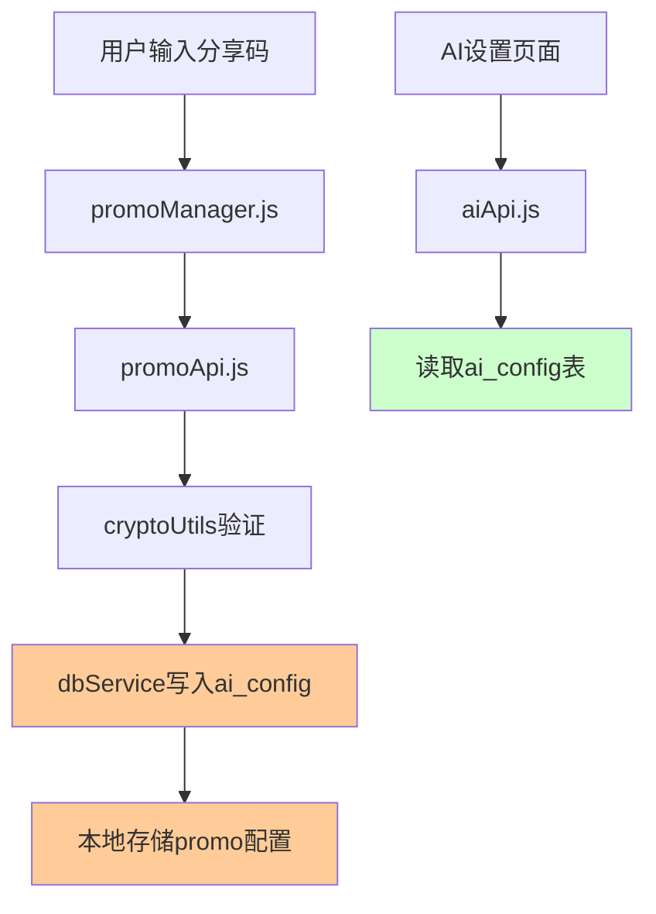
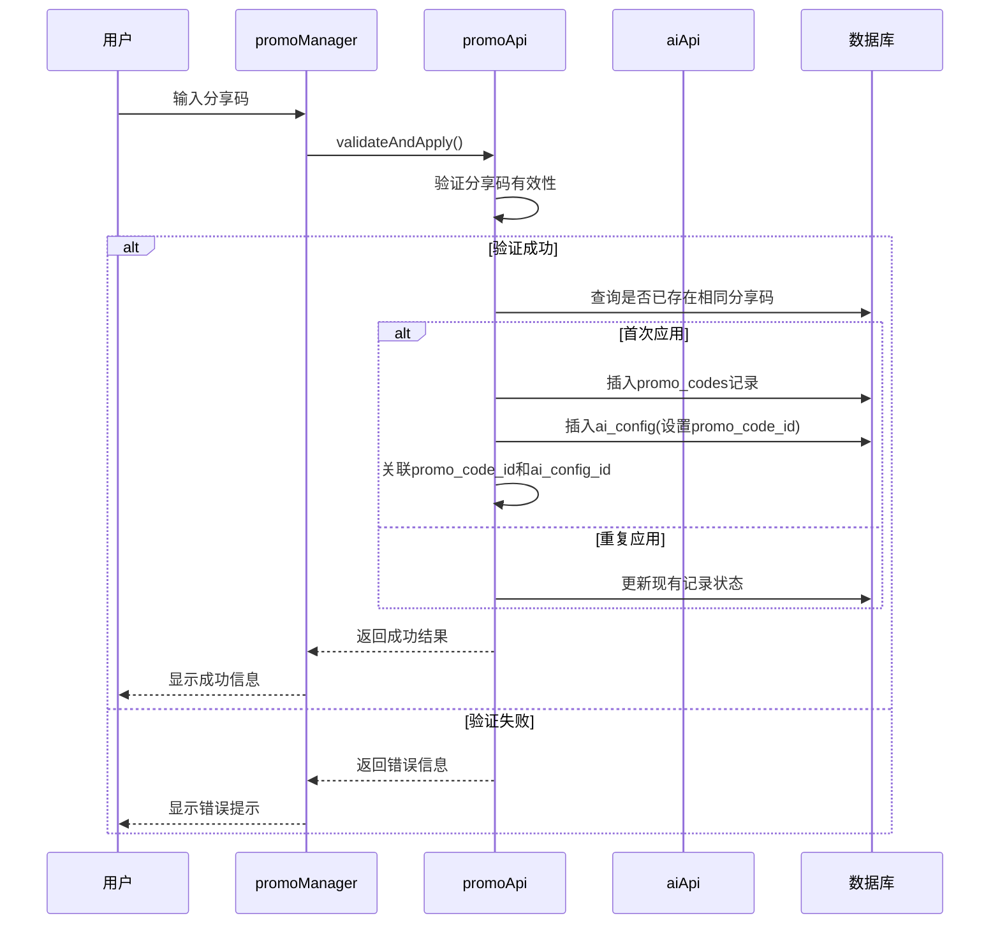
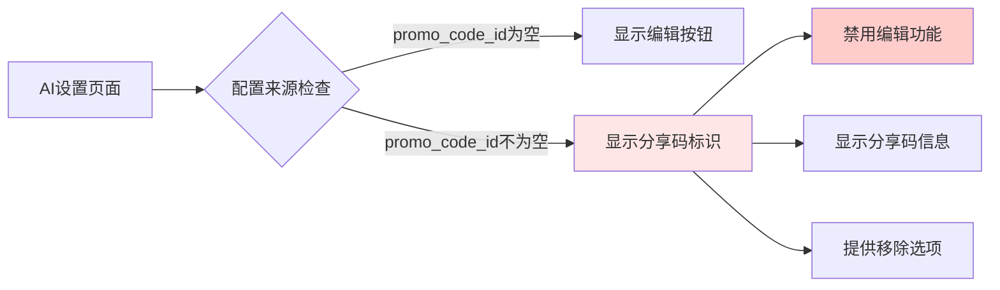

# 分享码系统优化设计

## 1. 概述

分享码系统类似于CDKey激活机制，旨在为用户提供快速配置AI能力的解决方案。当前系统存在架构设计和数据管理上的问题，需要进行系统性的重构优化。

## 2. 现状分析

### 2.1 当前架构



### 2.2 存在的核心问题

#### 问题1：数据一致性缺失
- **分离的数据存储**：分享码信息存储在本地存储中，AI配置存储在数据库表中
- **状态同步困难**：两个存储系统之间缺乏有效的关联机制
- **数据孤岛**：无法通过AI配置记录追溯到对应的分享码信息

#### 问题2：循环生成漏洞
- **逻辑缺陷**：通过分享码生成的AI配置可以再次生成分享码
- **无溯源标识**：数据库中的AI配置缺乏"来源"字段标识
- **安全风险**：可能导致分享码的无限传播和滥用

#### 问题3：联动机制缺失
- **单向流动**：分享码只能影响AI设置，反向联动缺失
- **状态不透明**：用户在AI设置页面无法识别哪些配置来自分享码
- **管理困难**：无法统一管理分享码相关的AI配置

#### 问题4：编辑限制不明确
- **权限模糊**：缺乏明确的编辑权限控制机制
- **用户体验差**：用户不理解为什么某些配置无法编辑
- **状态混乱**：分享码配置和普通配置在界面上无法区分

## 3. 优化设计方案

### 3.1 数据库结构优化

#### 3.1.1 ai_config表结构扩展

```sql
ALTER TABLE ai_config ADD COLUMN promo_code_id TEXT NULL;
```

**新增字段说明**：
- `promo_code_id`: 关联的分享码唯一标识符

**业务逻辑推断**：
- `promo_code_id IS NULL`: 手动创建的配置（可编辑）
- `promo_code_id IS NOT NULL`: 分享码创建的配置（不可编辑）

**来源类型推断**：
- 无需额外字段，通过 `promo_code_id` 即可判断配置来源
- 简化了数据模型，减少了维护复杂度

#### 3.1.2 新增promo_codes表

```sql
CREATE TABLE promo_codes (
    id INTEGER PRIMARY KEY AUTOINCREMENT,
    code_hash TEXT NOT NULL UNIQUE,
    user_id INTEGER NOT NULL,
    provider TEXT NOT NULL,
    model TEXT NOT NULL,
    applied_at DATETIME DEFAULT CURRENT_TIMESTAMP,
    expires_at DATETIME,
    status TEXT DEFAULT 'active',
    ai_config_id INTEGER,
    metadata TEXT,
    created_at DATETIME DEFAULT CURRENT_TIMESTAMP,
    updated_at DATETIME DEFAULT CURRENT_TIMESTAMP,
    FOREIGN KEY (user_id) REFERENCES users(id),
    FOREIGN KEY (ai_config_id) REFERENCES ai_config(id)
);

CREATE INDEX idx_promo_codes_user_id ON promo_codes(user_id);
CREATE INDEX idx_promo_codes_status ON promo_codes(status);
CREATE INDEX idx_promo_codes_expires_at ON promo_codes(expires_at);
```

### 3.2 系统架构重构

#### 3.2.1 新的数据流设计



#### 3.2.2 UI联动机制设计



### 3.3 核心功能优化

#### 3.3.1 分享码应用流程优化

```typescript
interface PromoCodeApplication {
  // 1. 强化验证机制
  async validatePromoCode(code: string): ValidationResult {
    // 验证格式、有效期、使用次数限制
    // 检查用户是否已使用过相同的分享码
    // 返回详细的验证结果
  }
  
  // 2. 统一的应用接口
  async applyPromoCode(code: string): ApplicationResult {
    // 创建事务确保数据一致性
    // 同时写入promo_codes和ai_config表
    // 建立双向关联关系
  }
  
  // 3. 智能冲突处理
  async handleConfigConflict(newConfig: AIConfig): ConflictResult {
    // 检测同供应商配置冲突
    // 提供覆盖、保留、重命名选项
    // 保持数据完整性
  }
}
```

#### 3.3.2 AI配置管理增强

```typescript
interface EnhancedAIConfig {
  // 1. 来源感知的配置管理
  async getConfigWithSource(configId: number): ConfigWithSource {
    // 返回配置及其来源信息
    // 包含编辑权限和关联信息
  }
  
  // 2. 权限控制机制
  async canEditConfig(configId: number): boolean {
    // 检查配置的可编辑性
    // 基于promo_code_id字段：NULL为可编辑，非NULL为不可编辑
  }
  
  // 3. 分享码配置特殊处理
  async updatePromoConfig(configId: number, updates: Partial<AIConfig>): Result {
    // 对分享码配置的更新进行特殊处理
    // 可能需要断开分享码关联
  }
}
```

### 3.4 用户界面优化

#### 3.4.1 AI设置页面改进

```vue
<template>
  <view class="config-item" :class="getConfigClass(config)">
    <!-- 配置基本信息 -->
    <view class="config-header">
      <view class="config-info">
        <text class="config-provider">{{ config.provider }}</text>
        <text class="config-model">{{ config.model }}</text>
        <!-- 分享码标识 -->
        <view class="source-indicator" v-if="config.promo_code_id">
          <nut-icon name="scan" size="12"></nut-icon>
          <text class="source-text">分享码</text>
        </view>
      </view>
      
      <!-- 操作按钮 -->
      <view class="config-actions">
        <!-- 编辑按钮 - 只有手动配置可编辑 -->
        <nut-button 
          v-if="isConfigEditable(config)" 
          size="small" 
          @click="editConfig(config)"
        >
          编辑
        </nut-button>
        
        <!-- 分享码特殊操作 -->
        <nut-button 
          v-if="config.promo_code_id" 
          size="small" 
          type="warning"
          @click="showPromoDetails(config)"
        >
          分享码详情
        </nut-button>
        
        <!-- 移除按钮 -->
        <nut-button 
          size="small" 
          type="danger"
          @click="removeConfig(config)"
        >
          移除
        </nut-button>
      </view>
    </view>
    
    <!-- 分享码配置的额外信息 -->
    <view v-if="config.promo_code_id" class="promo-info">
      <text class="promo-code-id">分享码ID: {{ config.promo_code_id }}</text>
      <text class="applied-time">应用时间: {{ formatTime(config.created_at) }}</text>
      <text class="expires-time" v-if="config.expires_at">
        过期时间: {{ formatTime(config.expires_at) }}
      </text>
    </view>
  </view>
</template>

<script>
export default {
  methods: {
    // 判断配置是否可编辑（简化版）
    isConfigEditable(config) {
      // 无promo_code_id表示手动创建，可编辑
      return !config.promo_code_id
    },
    
    getConfigClass(config) {
      const classes = ['config-item']
      if (config.is_active) classes.push('active')
      if (config.promo_code_id) classes.push('readonly', 'promo-config')
      return classes.join(' ')
    },
    
    // 获取配置来源类型显示文本
    getConfigSourceText(config) {
      return config.promo_code_id ? '分享码' : '手动创建'
    },
    
    // 获取配置来源图标
    getConfigSourceIcon(config) {
      return config.promo_code_id ? 'scan' : 'edit'
    }
  }
}
</script>
```

#### 3.4.2 分享码状态展示

```vue
<template>
  <view class="promo-status-section">
    <view class="section-title">分享码状态</view>
    
    <!-- 当前激活的分享码 -->
    <view v-if="activePromoCode" class="active-promo-card">
      <view class="promo-header">
        <nut-icon name="shield-check" color="#00B42A"></nut-icon>
        <text class="status-text">已激活</text>
        <text class="provider-info">{{ activePromoCode.provider }} - {{ activePromoCode.model }}</text>
      </view>
      
      <view class="promo-details">
        <text class="detail-item">应用时间: {{ formatTime(activePromoCode.applied_at) }}</text>
        <text class="detail-item">剩余时间: {{ getRemainingTime(activePromoCode.expires_at) }}</text>
      </view>
      
      <view class="promo-actions">
        <nut-button size="small" @click="viewPromoDetails">查看详情</nut-button>
        <nut-button size="small" type="warning" @click="removePromoCode">移除分享码</nut-button>
      </view>
    </view>
    
    <!-- 无分享码状态 -->
    <view v-else class="no-promo-card">
      <nut-icon name="shield-exclamation" color="#86909C"></nut-icon>
      <text class="no-promo-text">暂无激活的分享码</text>
      <nut-button type="primary" @click="showApplyPromo">应用分享码</nut-button>
    </view>
  </view>
</template>
```

### 3.5 安全机制强化

#### 3.5.1 防循环生成机制

```typescript
class PromoCodeSecurity {
  // 检查配置是否可用于生成分享码
  async canGeneratePromoFromConfig(configId: number): Promise<boolean> {
    const config = await this.getConfigWithSource(configId)
    
    // 来自分享码的配置不能生成新的分享码
    if (config.source_type === 'promo_code') {
      return false
    }
    
    // 其他安全检查...
    return true
  }
  
  // 分享码使用追踪
  async trackPromoCodeUsage(codeHash: string, userId: number): Promise<void> {
    // 记录分享码的使用历史
    // 用于分析和安全监控
  }
}
```

#### 3.5.2 权限管理机制

```typescript
interface PermissionManager {
  // 检查编辑权限（简化版）
  canEdit(config: AIConfig, user: User): boolean {
    // 管理员可以编辑所有配置
    if (user.role === 'admin') return true
    
    // 普通用户只能编辑自己的非分享码配置
    return !config.promo_code_id && config.user_id === user.id
  }
  
  // 检查删除权限
  canDelete(config: AIConfig, user: User): boolean {
    // 用户可以删除自己的配置，包括分享码配置
    return config.user_id === user.id
  }
}
```

## 4. 实施计划

### 4.1 Phase 1: 数据库结构升级
- 扩展ai_config表结构
- 创建promo_codes表
- 数据迁移脚本
- 索引优化

### 4.2 Phase 2: 核心API重构
- promoApi.js重构
- aiApi.js增强
- 数据一致性保证
- 事务处理机制

### 4.3 Phase 3: UI界面优化
- AI设置页面改进
- 分享码状态展示
- 权限控制实现
- 用户体验优化

### 4.4 Phase 4: 安全机制完善
- 防循环生成
- 权限管理
- 审计日志
- 异常处理

## 5. 技术实现要点

### 5.1 数据库迁移脚本

```sql
-- 数据库升级脚本
BEGIN TRANSACTION;

-- 添加新字段到ai_config表
ALTER TABLE ai_config ADD COLUMN promo_code_id TEXT NULL;

-- 创建promo_codes表
CREATE TABLE promo_codes (
    id INTEGER PRIMARY KEY AUTOINCREMENT,
    code_hash TEXT NOT NULL UNIQUE,
    user_id INTEGER NOT NULL,
    provider TEXT NOT NULL,
    model TEXT NOT NULL,
    applied_at DATETIME DEFAULT CURRENT_TIMESTAMP,
    expires_at DATETIME,
    status TEXT DEFAULT 'active',
    ai_config_id INTEGER,
    metadata TEXT,
    created_at DATETIME DEFAULT CURRENT_TIMESTAMP,
    updated_at DATETIME DEFAULT CURRENT_TIMESTAMP,
    FOREIGN KEY (user_id) REFERENCES users(id),
    FOREIGN KEY (ai_config_id) REFERENCES ai_config(id)
);

-- 创建索引
CREATE INDEX idx_promo_codes_user_id ON promo_codes(user_id);
CREATE INDEX idx_promo_codes_status ON promo_codes(status);
CREATE INDEX idx_promo_codes_expires_at ON promo_codes(expires_at);
CREATE INDEX idx_ai_config_promo_code_id ON ai_config(promo_code_id);
CREATE INDEX idx_ai_config_editable ON ai_config(user_id) WHERE promo_code_id IS NULL;

COMMIT;
```

### 5.2 核心API接口设计

```typescript
interface PromoCodeAPI {
  // 应用分享码（重构版）
  applyPromoCode(code: string): Promise<{
    success: boolean
    promoCodeId?: string
    aiConfigId?: number
    message?: string
    error?: string
  }>
  
  // 获取分享码详情
  getPromoCodeDetails(promoCodeId: string): Promise<PromoCodeDetails>
  
  // 移除分享码
  removePromoCode(promoCodeId: string): Promise<{
    success: boolean
    restoredConfig?: AIConfig
    message?: string
  }>
  
  // 检查分享码状态
  checkPromoCodeStatus(userId: number): Promise<PromoCodeStatus[]>
}

interface AIConfigAPI {
  // 获取带来源信息的配置列表
  getConfigsWithSource(userId: number): Promise<AIConfigWithSource[]>
  
  // 权限检查 - 基于promo_code_id字段
  canEditConfig(configId: number, userId: number): Promise<boolean>
  
  // 安全的配置更新
  updateConfigSafely(
    configId: number, 
    updates: Partial<AIConfig>,
    userId: number
  ): Promise<UpdateResult>
  
  // 检查配置是否为分享码配置
  isPromoCodeConfig(configId: number): Promise<boolean>
  
  // 获取可编辑的配置列表
  getEditableConfigs(userId: number): Promise<AIConfig[]>
}
```

## 7. 核心实现示例

### 7.1 可编辑性判断逻辑

```javascript
// aiApi.js 中的实现
class AiApi {
  /**
   * 检查配置是否可编辑
   * @param {number} configId - 配置ID
   * @param {number} userId - 用户ID
   * @returns {Promise<boolean>}
   */
  async canEditConfig(configId, userId = null) {
    if (!userId) {
      userId = userStore.getCurrentUserId()
    }
    
    await this.ensureDBInit()
    
    try {
      const config = await dbService.findOne(
        'ai_config', 
        'id = ? AND user_id = ?', 
        [configId, userId]
      )
      
      if (!config) {
        return false
      }
      
      // 核心逻辑：promo_code_id存在则不可编辑
      return !config.promo_code_id
    } catch (error) {
      console.error('检查配置编辑权限失败:', error)
      return false
    }
  }
  
  /**
   * 检查配置是否为分享码配置（简化版）
   * @param {number} configId - 配置ID
   * @returns {Promise<boolean>}
   */
  async isPromoCodeConfig(configId) {
    try {
      const config = await dbService.findOne('ai_config', 'id = ?', [configId])
      return config && !!config.promo_code_id
    } catch (error) {
      console.error('检查分享码配置失败:', error)
      return false
    }
  }
  
  /**
   * 获取可编辑的配置列表
   * @param {number} userId - 用户ID
   * @returns {Promise<Array>}
   */
  async getEditableConfigs(userId = null) {
    if (!userId) {
      userId = userStore.getCurrentUserId()
    }
    
    await this.ensureDBInit()
    
    try {
      // 查询promo_code_id为null的配置（可编辑配置）
      const configs = await dbService.findMany(
        'ai_config',
        'user_id = ? AND promo_code_id IS NULL',
        [userId],
        'created_at DESC'
      )
      
      return configs
    } catch (error) {
      console.error('获取可编辑配置列表失败:', error)
      return []
    }
  }
  
  /**
   * 安全的配置更新（检查编辑权限）
   * @param {number} configId - 配置ID
   * @param {Object} updates - 更新数据
   * @param {number} userId - 用户ID
   * @returns {Promise<Object>}
   */
  async updateConfigSafely(configId, updates, userId = null) {
    if (!userId) {
      userId = userStore.getCurrentUserId()
    }
    
    try {
      // 检查编辑权限
      const canEdit = await this.canEditConfig(configId, userId)
      
      if (!canEdit) {
        return {
          success: false,
          error: '该配置不可编辑（来自分享码的配置无法修改）'
        }
      }
      
      // 执行更新
      const result = await this.updateAIConfig(configId, updates, userId)
      
      return {
        success: true,
        data: result
      }
    } catch (error) {
      console.error('安全更新配置失败:', error)
      return {
        success: false,
        error: error.message
      }
    }
  }
}
```

### 7.2 前端组件实现

```javascript
// ai-settings.vue 中的方法
export default {
  methods: {
    /**
     * 判断配置是否可编辑
     * @param {Object} config - AI配置对象
     * @returns {boolean}
     */
    isConfigEditable(config) {
      // 简化的判断逻辑：promo_code_id为空表示可编辑
      return !config.promo_code_id
    },
    
    /**
     * 获取配置样式类
     * @param {Object} config - AI配置对象
     * @returns {string}
     */
    getConfigClass(config) {
      const classes = ['config-item']
      
      if (config.is_active) {
        classes.push('active')
      }
      
      if (!this.isConfigEditable(config)) {
        classes.push('readonly', 'promo-config')
      }
      
      return classes.join(' ')
    },
    
    /**
     * 编辑配置（带权限检查）
     * @param {Object} config - AI配置对象
     */
    async editConfig(config) {
      // 再次检查编辑权限
      if (!this.isConfigEditable(config)) {
        uni.showToast({
          title: '分享码配置不可编辑',
          icon: 'none'
        })
        return
      }
      
      // 执行编辑逻辑
      this.editingConfig = config
      this.formData = { ...config }
      this.showAddConfig = true
    },
    
    /**
     * 保存配置（安全更新）
     */
    async saveConfig() {
      try {
        if (this.editingConfig) {
          // 使用安全更新方法
          const result = await aiApi.updateConfigSafely(
            this.editingConfig.id, 
            this.formData
          )
          
          if (!result.success) {
            uni.showToast({
              title: result.error,
              icon: 'error'
            })
            return
          }
        } else {
          // 新增配置
          await aiApi.addAIConfig(this.formData)
        }
        
        // 重新加载配置列表
        await this.loadConfigList()
        this.resetForm()
        
        uni.showToast({
          title: '保存成功',
          icon: 'success'
        })
      } catch (error) {
        console.error('保存配置失败:', error)
        uni.showToast({
          title: '保存失败',
          icon: 'error'
        })
      }
    }
  }
}
```

### 7.3 SQL查询优化

```sql
-- 查询可编辑的配置
SELECT * FROM ai_config 
WHERE user_id = ? AND promo_code_id IS NULL 
ORDER BY created_at DESC;

-- 查询分享码配置
SELECT ac.*, pc.code_hash, pc.expires_at 
FROM ai_config ac 
LEFT JOIN promo_codes pc ON ac.promo_code_id = pc.id 
WHERE ac.user_id = ? AND ac.promo_code_id IS NOT NULL;

-- 检查配置是否可编辑
SELECT 
  id,
  provider,
  model,
  CASE 
    WHEN promo_code_id IS NULL THEN 1 
    ELSE 0 
  END as is_editable
FROM ai_config 
WHERE id = ? AND user_id = ?;

-- 统计各类型配置数量（简化版）
SELECT 
  CASE 
    WHEN promo_code_id IS NULL THEN 'manual'
    ELSE 'promo_code'
  END as source_type,
  COUNT(*) as total_count,
  COUNT(CASE WHEN promo_code_id IS NULL THEN 1 END) as manual_count,
  COUNT(CASE WHEN promo_code_id IS NOT NULL THEN 1 END) as promo_count
FROM ai_config 
WHERE user_id = ? 
GROUP BY (CASE WHEN promo_code_id IS NULL THEN 'manual' ELSE 'promo_code' END);
```

## 9. 最终简化设计总结

### 9.1 极简数据模型

通过您的优化建议，我们将原本复杂的数据模型简化为最核心的设计：

```sql
-- 只需要一个字段就能解决所有问题
ALTER TABLE ai_config ADD COLUMN promo_code_id TEXT NULL;
```

### 9.2 业务逻辑映射

```javascript
// 一个字段解决所有判断逻辑
const config = {
  id: 1,
  provider: 'deepseek',
  model: 'deepseek-chat',
  promo_code_id: null // 或者 'promo_123'
}

// 所有业务逻辑都基于这一个字段
const isEditable = !config.promo_code_id     // 可编辑性
const isPromoConfig = !!config.promo_code_id // 是否为分享码配置
const sourceType = config.promo_code_id ? '分享码' : '手动创建' // 来源类型
const canGenerate = !config.promo_code_id    // 是否可生成分享码
```

### 9.3 优化效果对比

| 方案 | 数据库字段 | 代码复杂度 | 维护成本 | 性能 |
|------|-----------|-----------|----------|------|
| **优化前** | 4个字段 | 高 | 高 | 中等 |
| **优化后** | 1个字段 | 低 | 低 | 高 |

**优化前的冗余设计**：
- `source_type`: 冗余，可通过 `promo_code_id` 推断
- `is_editable`: 冗余，可通过 `promo_code_id` 推断  
- `source_metadata`: 冗余，目前业务不需要

**优化后的极简设计**：
- `promo_code_id`: 唯一核心字段，承载所有业务逻辑

### 9.4 设计原则体现

1. **单一数据源原则**：一个字段承载一个概念
2. **DRY原则**：不重复存储可推断的信息
3. **KISS原则**：保持设计简单直接
4. **数据规范化**：消除冗余依赖

### 9.5 实际代码简化示例

```javascript
// 优化前：需要多个字段判断
function isConfigEditable(config) {
  return config.source_type === 'manual' && 
         config.is_editable === 1 && 
         !config.promo_code_id
}

// 优化后：一行代码搞定
function isConfigEditable(config) {
  return !config.promo_code_id
}
```

这种极简设计不仅减少了存储空间，还大大降低了代码复杂度和维护成本，是数据库设计和系统架构优化的典型案例。

## 10. 测试策略

### 10.1 单元测试覆盖
- promoApi核心方法测试
- aiApi权限控制测试
- 数据一致性验证测试
- 安全机制测试
- 可编辑性判断逻辑测试

### 10.2 集成测试场景
- 分享码应用完整流程
- AI配置管理流程
- 权限控制集成测试
- 数据迁移测试
- 编辑权限联动测试

### 10.3 用户体验测试
- UI界面响应性测试
- 操作流程可用性测试
- 错误处理用户体验测试
- 权限提示友好性测试
