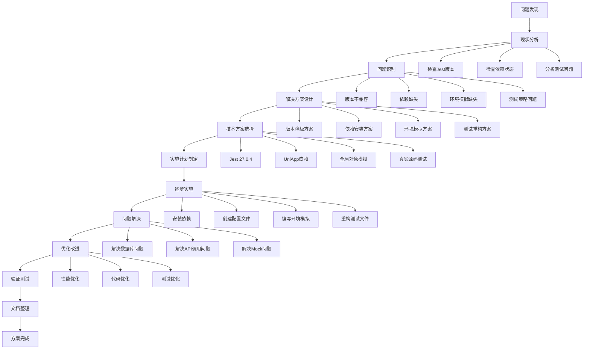
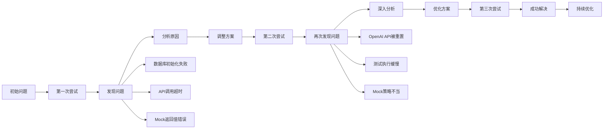

# 思维链解决过程可视化

## 🧠 思维链流程图



## 🔄 迭代优化过程



## 📊 问题解决时间线

```mermaid
gantt
    title UniApp Jest集成问题解决时间线
    dateFormat  X
    axisFormat %M分钟
    
    section 问题分析
    现状检查           :done, check, 0, 5
    问题识别           :done, identify, 5, 10
    方案设计           :done, design, 10, 15
    
    section 基础实施
    依赖安装           :done, deps, 15, 20
    配置创建           :done, config, 20, 25
    环境模拟           :done, mock, 25, 30
    
    section 测试重构
    测试文件修改       :done, test1, 30, 35
    第一次测试         :done, test1run, 35, 40
    问题修复           :done, fix1, 40, 45
    
    section 优化改进
    第二次测试         :done, test2, 45, 50
    深度优化           :done, optimize, 50, 55
    最终验证           :done, final, 55, 60
    
    section 文档整理
    方案文档           :done, doc, 60, 65
    总结报告           :done, summary, 65, 70
```



## 🎯 关键决策点

### 决策点1：Jest版本选择
**问题：** 当前Jest 29.7.0与UniApp CLI项目不兼容  
**选择：** 降级到Jest 27.0.4  
**理由：** UniApp官方推荐版本，兼容性最佳

### 决策点2：测试策略选择
**问题：** 使用Mock测试还是真实源码测试  
**选择：** 真实源码测试 + 智能Mock  
**理由：** 更接近真实环境，测试更有价值

### 决策点3：Mock策略选择
**问题：** 如何平衡测试真实性和独立性  
**选择：** 只Mock外部依赖，测试真实业务逻辑  
**理由：** 既保证测试真实性，又保持测试独立性

## 🔍 问题解决模式

### 模式1：版本兼容性问题
```
问题 → 检查版本 → 查找兼容版本 → 降级安装 → 验证兼容性
```

### 模式2：依赖缺失问题
```
问题 → 分析需求 → 查找依赖 → 安装依赖 → 配置使用
```

### 模式3：环境模拟问题
```
问题 → 分析环境需求 → 创建模拟对象 → 配置测试环境 → 验证模拟效果
```

### 模式4：测试策略问题
```
问题 → 分析测试目标 → 设计测试策略 → 实施测试方案 → 优化测试效果
```

## 📈 学习收获

### 技术收获
1. **UniApp测试环境搭建** - 掌握了完整的UniApp测试环境配置
2. **Jest配置优化** - 学会了Jest的高级配置和优化技巧
3. **Mock策略设计** - 掌握了智能Mock策略的设计原则
4. **测试重构技巧** - 学会了从Mock测试向真实源码测试的重构方法

### 方法论收获
1. **思维链问题解决** - 学会了系统性的问题分析和解决流程
2. **迭代优化方法** - 掌握了持续改进和优化的方法
3. **文档化思维** - 学会了将解决过程文档化的重要性

### 最佳实践
1. **先分析后实施** - 充分分析问题后再开始实施
2. **小步快跑** - 分步骤实施，及时验证效果
3. **持续优化** - 在实施过程中不断优化和改进
4. **文档先行** - 及时记录解决过程和经验

## 🚀 后续应用

### 类似问题解决
- 其他框架的测试集成问题
- 版本兼容性问题
- 环境配置问题
- 测试策略优化问题

### 知识扩展
- 深入学习Jest高级特性
- 探索其他测试框架
- 研究测试自动化最佳实践
- 学习CI/CD集成测试

### 团队分享
- 分享思维链问题解决方法
- 推广测试最佳实践
- 建立测试知识库
- 培养测试文化

---

**文档版本：** v1.0  
**创建时间：** 2024-01-15  
**维护者：** AI Assistant  
**状态：** 已完成 ✅
