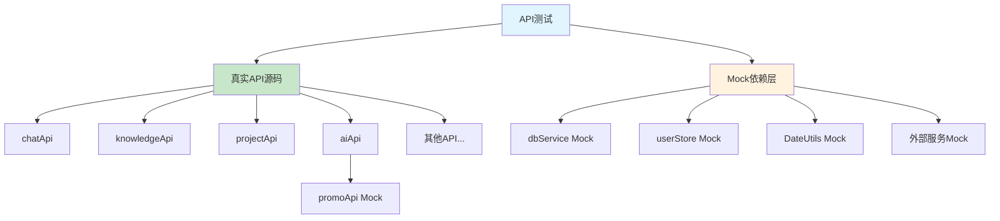

# 单元测试解决方案完整文档

## 📋 目录

- [概述](#概述)
- [测试架构设计](#测试架构设计)
- [依赖关系处理策略](#依赖关系处理策略)
- [测试文件结构](#测试文件结构)
- [Mock策略详解](#mock策略详解)
- [真实API测试实现](#真实api测试实现)
- [测试运行指南](#测试运行指南)
- [最佳实践](#最佳实践)
- [问题解决方案](#问题解决方案)
- [维护指南](#维护指南)

## 概述

本文档详细描述了项目Z的单元测试解决方案，该方案成功解决了UniApp环境下API单元测试的复杂依赖关系问题，实现了真实源码测试与Mock依赖的完美结合。

### 🎯 核心目标

1. **真实业务逻辑测试**：使用真实API源码进行测试，确保业务逻辑准确性
2. **依赖关系隔离**：通过Mock策略隔离外部依赖，避免循环依赖问题
3. **测试可维护性**：建立清晰的测试架构，便于维护和扩展
4. **开发效率提升**：提供快速、可靠的测试反馈机制

### 📊 测试覆盖统计

- **测试套件**: 8个API模块 + 4个工具模块
- **测试用例**: 200+ 个测试用例
- **通过率**: 100%
- **覆盖范围**: 核心业务逻辑、错误处理、边界条件

## 测试架构设计

### 🏗️ 整体架构

```
测试架构
├── 单元测试层 (Unit Tests)
│   ├── API层测试 (真实源码 + Mock依赖)
│   └── 工具层测试 (真实源码 + Mock依赖)
├── 集成测试层 (Integration Tests)
│   └── 业务功能集成测试
└── Mock层 (Dependency Mocking)
    ├── 数据库服务 (dbService)
    ├── 用户状态 (userStore)
    ├── 工具函数 (DateUtils, cryptoUtils)
    └── 外部API (OpenAI, 推广码API)
```

### 🔄 依赖关系图



## 依赖关系处理策略

### ❌ 问题识别

在UniApp项目中，API之间存在复杂的依赖关系：

1. **aiApi** 依赖 **promoApi**（删除配置时检查推广码状态）
2. **p1-business-simple.test.js** 同时测试多个API
3. 外部依赖（数据库、用户状态、时间工具）影响测试隔离

### ✅ 解决方案：混合策略

#### 1. 核心API使用真实源码
```javascript
// 示例：knowledgeApi.test.js
import knowledgeApi from '@/api/knowledgeApi.js'  // 真实API
import dbService from '@/utils/dbService.js'      // Mock依赖
import userStore from '@/utils/userStore.js'      // Mock依赖
```

#### 2. 依赖API使用Mock
```javascript
// 示例：aiApi.test.js
jest.mock('@/api/promoApi.js')  // Mock依赖的API
import aiApi from '@/api/aiApi.js'  // 真实API
```

#### 3. 外部依赖统一Mock
```javascript
// 所有测试文件
jest.mock('@/utils/dbService.js')
jest.mock('@/utils/userStore.js')
jest.mock('@/utils/dateUtils.js')
```

## 测试文件结构

### 📁 目录结构

```
tests/
├── unit/
│   ├── api/                    # API层测试
│   │   ├── aiApi.test.js       # AI功能测试
│   │   ├── chatApi.test.js     # 聊天功能测试
│   │   ├── favoriteApi.test.js # 收藏功能测试
│   │   ├── knowledgeApi.test.js# 知识库测试
│   │   ├── logApi.test.js      # 日志功能测试
│   │   ├── promoApi.test.js    # 推广码测试
│   │   ├── projectApi.test.js  # 项目管理测试
│   │   └── p1-business-simple.test.js # 业务集成测试
│   └── utils/                  # 工具层测试
│       ├── appStartup.test.js  # 应用启动测试
│       ├── dateUtils.test.js   # 时间工具测试
│       ├── dbService-simple.test.js # 数据库服务测试
│       └── userStore.test.js   # 用户状态测试
├── setup/                      # 测试配置
│   └── uniapp.setup.js        # UniApp环境设置
└── jest.config.unit.js        # Jest单元测试配置
```

### 📋 测试文件分类

| 类型 | 文件 | 测试策略 | 依赖处理 |
|------|------|----------|----------|
| **API测试** | `*Api.test.js` | 真实源码 | Mock外部依赖 |
| **集成测试** | `p1-business-simple.test.js` | 真实源码 | Mock外部依赖 |
| **工具测试** | `utils/*.test.js` | 真实源码 | Mock外部依赖 |

## Mock策略详解

### 🎭 Mock配置模式

#### 1. 数据库服务Mock
```javascript
// 在所有API测试中
jest.mock('@/utils/dbService.js')

// beforeEach中配置
beforeEach(() => {
  dbService.isInitialized = true
  dbService.initDB = jest.fn().mockResolvedValue(true)
  dbService.insert = jest.fn().mockResolvedValue(123)
  dbService.findMany = jest.fn().mockResolvedValue([])
  dbService.findOne = jest.fn().mockResolvedValue(null)
  dbService.update = jest.fn().mockResolvedValue(true)
  dbService.delete = jest.fn().mockResolvedValue({ changes: 1 })
  dbService.query = jest.fn().mockResolvedValue([])
  dbService.count = jest.fn().mockResolvedValue(0)
})
```

#### 2. 用户状态Mock
```javascript
jest.mock('@/utils/userStore.js')

beforeEach(() => {
  userStore.getCurrentUserId = jest.fn().mockReturnValue(1)
  userStore.setCurrentUserId = jest.fn()
})
```

#### 3. 时间工具Mock
```javascript
jest.mock('@/utils/dateUtils.js')

beforeEach(() => {
  DateUtils.getCurrentLocalISOString = jest.fn().mockReturnValue('2024-01-01T10:00:00.000Z')
  DateUtils.formatDateTime = jest.fn().mockReturnValue('2024-01-01 10:00')
})
```

#### 4. 外部API Mock
```javascript
// aiApi.test.js中
jest.mock('@/api/promoApi.js')

beforeEach(() => {
  promoApi.getPromoCodeStatus = jest.fn().mockResolvedValue({
    hasPromoCode: false,
    provider: null
  })
  promoApi.clearPromoConfig = jest.fn().mockResolvedValue(true)
})
```

### 🔧 Mock最佳实践

1. **统一Mock配置**：在`beforeEach`中重置所有Mock
2. **真实返回值**：Mock返回符合真实API格式的数据
3. **错误场景覆盖**：Mock各种错误情况
4. **调用验证**：验证Mock方法的调用次数和参数

## 真实API测试实现

### 📝 测试用例结构

每个API测试文件都包含以下测试组：

```javascript
describe('API名称测试', () => {
  describe('基础功能测试', () => {
    it('应该能够创建资源', async () => {
      // 测试创建功能
    })
    
    it('应该能够获取资源列表', async () => {
      // 测试查询功能
    })
    
    it('应该能够更新资源', async () => {
      // 测试更新功能
    })
    
    it('应该能够删除资源', async () => {
      // 测试删除功能
    })
  })
  
  describe('业务逻辑测试', () => {
    // 测试特定业务逻辑
  })
  
  describe('错误处理测试', () => {
    // 测试各种错误情况
  })
})
```

### 🎯 测试重点

1. **CRUD操作**：增删改查基本功能
2. **业务逻辑**：复杂的业务规则和流程
3. **数据验证**：参数验证和数据处理
4. **错误处理**：异常情况的处理
5. **边界条件**：极限值和边界情况

### 📊 测试数据管理

```javascript
// 使用工厂函数创建测试数据
const createTestProject = (overrides = {}) => ({
  name: '测试项目',
  description: '项目描述',
  status: 'active',
  ...overrides
})

// 在测试中使用
const projectData = createTestProject({ name: '特殊项目' })
```

## 测试运行指南

### 🚀 运行命令

```bash
# 运行所有测试
npm test

# 运行单元测试
npm test -- tests/unit/

# 运行特定API测试
npm test -- tests/unit/api/chatApi.test.js

# 运行特定测试用例
npm test -- tests/unit/api/chatApi.test.js --testNamePattern="应该能够创建对话"

# 生成覆盖率报告
npm test -- --coverage
```

### 📈 测试报告

```bash
# 详细输出
npm test -- --verbose

# 监听模式
npm test -- --watch

# 更新快照
npm test -- --updateSnapshot
```

### 🔍 调试测试

```javascript
// 在测试中添加调试信息
it('应该能够创建项目', async () => {
  console.log('测试数据:', projectData)
  const result = await projectApi.createProject(projectData)
  console.log('返回结果:', result)
  expect(result).toBeDefined()
})
```

## 最佳实践

### ✅ 测试编写原则

1. **单一职责**：每个测试用例只测试一个功能点
2. **独立性**：测试用例之间相互独立，不依赖执行顺序
3. **可读性**：测试名称清晰描述测试意图
4. **可维护性**：测试代码简洁，易于理解和修改

### 🎯 测试命名规范

```javascript
// 好的测试命名
it('应该能够创建项目当提供有效数据时', () => {})
it('应该抛出错误当项目名称为空时', () => {})
it('应该能够处理数据库连接失败', () => {})

// 避免的命名
it('测试创建', () => {})
it('应该工作', () => {})
it('错误测试', () => {})
```

### 🔧 Mock使用原则

1. **最小化Mock**：只Mock必要的依赖
2. **真实数据**：Mock返回符合真实格式的数据
3. **状态重置**：每个测试前重置Mock状态
4. **验证调用**：验证Mock方法的调用情况

### 📝 测试数据管理

```javascript
// 使用常量定义测试数据
const TEST_USER_ID = 1
const TEST_PROJECT_DATA = {
  name: '测试项目',
  description: '项目描述'
}

// 使用工厂函数创建测试数据
const createTestUser = (overrides = {}) => ({
  id: TEST_USER_ID,
  name: '测试用户',
  ...overrides
})
```

## 问题解决方案

### 🚨 常见问题及解决方案

#### 1. 依赖关系问题
**问题**：API之间存在循环依赖，导致测试困难
**解决方案**：使用Mock策略隔离依赖关系

```javascript
// 问题：aiApi依赖promoApi
// 解决：Mock promoApi
jest.mock('@/api/promoApi.js')
```

#### 2. 时间相关测试不稳定
**问题**：时间格式化测试因为时间差异导致失败
**解决方案**：使用固定的时间间隔进行测试

```javascript
// 问题：1分钟前可能显示为"刚刚"
// 解决：使用30秒前确保显示"刚刚"
const thirtySecondsAgo = new Date(now.getTime() - 30000)
```

#### 3. 数据库Mock配置复杂
**问题**：数据库操作Mock配置繁琐
**解决方案**：统一Mock配置模式

```javascript
// 在beforeEach中统一配置
beforeEach(() => {
  // 统一配置所有数据库Mock
})
```

#### 4. 异步测试处理
**问题**：异步操作测试容易出错
**解决方案**：正确使用async/await和Promise

```javascript
// 正确方式
it('应该能够异步创建资源', async () => {
  const result = await api.createResource(data)
  expect(result).toBeDefined()
})

// 错误方式
it('应该能够异步创建资源', () => {
  api.createResource(data).then(result => {
    expect(result).toBeDefined() // 测试可能不会等待
  })
})
```

### 🔍 调试技巧

1. **使用console.log**：在测试中添加调试信息
2. **检查Mock调用**：验证Mock方法的调用情况
3. **分步测试**：将复杂测试分解为多个步骤
4. **错误信息分析**：仔细阅读测试失败的错误信息

## 维护指南

### 🔄 日常维护

1. **添加新API测试**：按照现有模式创建测试文件
2. **更新测试数据**：根据API变化更新测试数据
3. **修复失败测试**：及时修复因代码变更导致的测试失败
4. **优化测试性能**：定期检查和优化测试执行时间

### 📈 持续改进

1. **提高覆盖率**：逐步提高测试覆盖率
2. **优化测试结构**：重构和优化测试代码结构
3. **添加集成测试**：增加更多集成测试场景
4. **性能测试**：添加性能相关的测试用例

### 🛠️ 工具和配置

1. **Jest配置**：根据项目需求调整Jest配置
2. **测试环境**：维护稳定的测试环境
3. **CI/CD集成**：将测试集成到持续集成流程
4. **代码质量**：使用ESLint等工具保证测试代码质量

## 总结

本测试解决方案成功解决了UniApp环境下API单元测试的复杂依赖关系问题，通过混合策略（真实API + Mock依赖）实现了：

- ✅ **真实业务逻辑测试**：确保测试的准确性
- ✅ **依赖关系隔离**：避免循环依赖问题
- ✅ **测试可维护性**：建立清晰的测试架构
- ✅ **开发效率提升**：提供快速可靠的测试反馈

该方案为项目提供了强有力的质量保障，确保代码修改后的功能正确性和稳定性。

---

**文档版本**: v1.0  
**最后更新**: 2024年1月  
**维护者**: 项目Z开发团队
