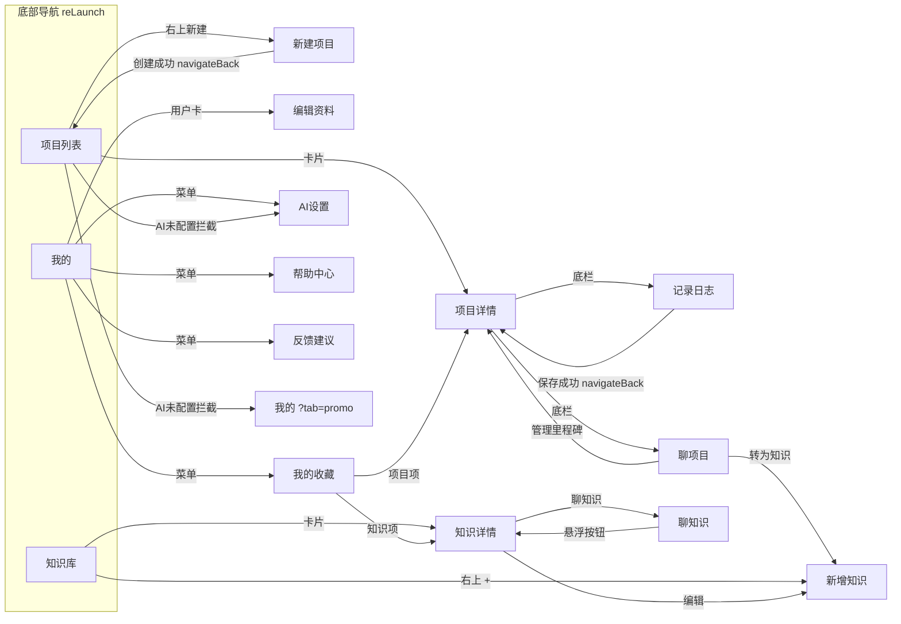
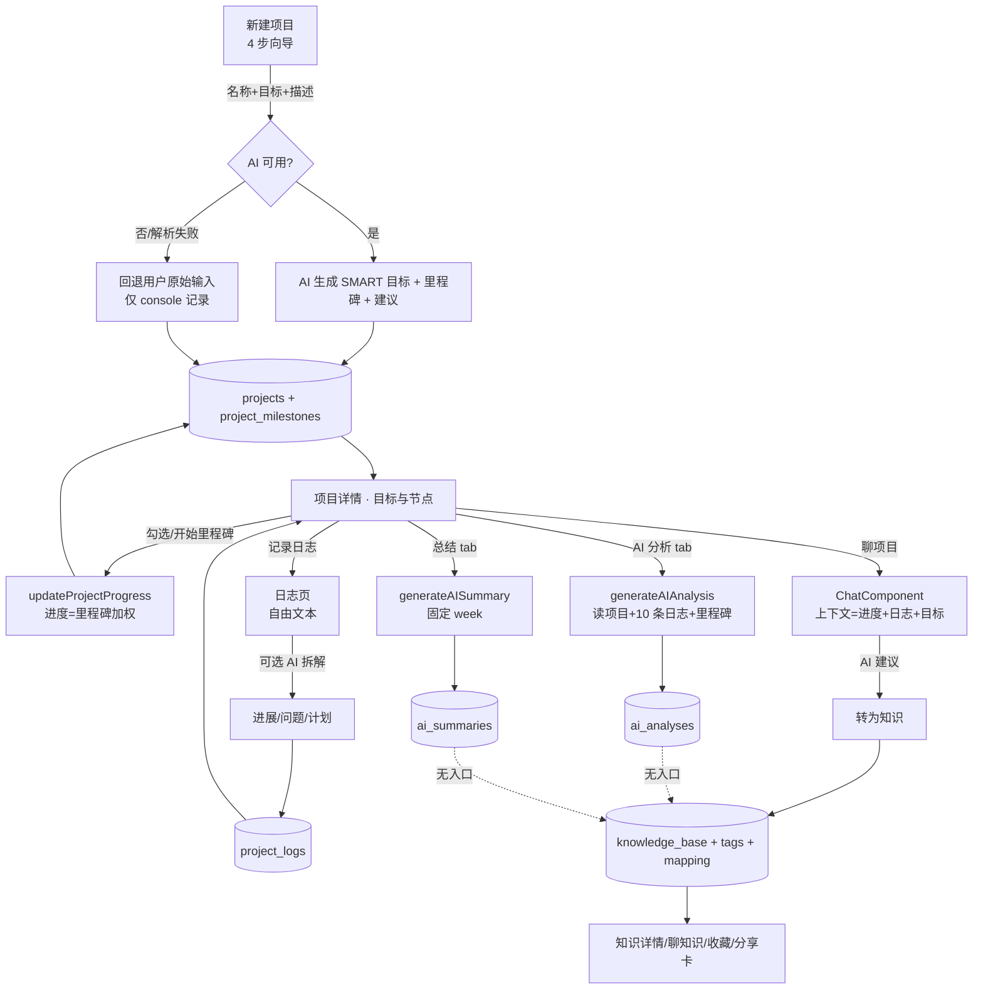

# 02 · 旧版用户工作流与页面行为审计（uni-app / Vue3 / SQLite）

> 审计对象：`D:\ws-research\project-z-public`（分支 `master`，`manifest.json` versionName 1.0.6 / versionCode 100）。
> 方法：只读源码。逐页读 `pages/**`、`components/**`、`custom-tab-bar/index.vue`、`pages.json`、`api/*Api.js` 关键方法、`README.md` 功能章节、`AGENTS.md` 约定；未运行 App、未连真库，因此**运行时行为标注“未确认”**，只写源码可证事实。
> 约束：本次审计**未修改任何源码、未提交 git**；本文件为唯一新增产物。

## 0. 证据基线与阅读范围

| 类别 | 已读文件 |
|---|---|
| 路由/导航 | `pages.json`（17 个注册页）、`custom-tab-bar/index.vue`、`components/CustomNavbar.vue` |
| 项目域 | `pages/project/list.vue`(675 行)、`create.vue`(1063)、`detail.vue`(2278)、`log.vue`(690)、`chat.vue`(2063) |
| 知识域 | `pages/knowledge/index.vue`(475)、`detail.vue`(412)、`create.vue`(1017)、`chat.vue`(816) |
| 我的域 | `pages/profile/index.vue`(2816)、`ai-settings.vue`(1099)、`edit.vue`(474)、`favorites.vue`(247)、`stats.vue`(651)、`help.vue`(396)、`feedback.vue`(562) |
| 公共组件 | `components/ChatComponent.vue`(2078)、`ShareCardComponent.vue`(912)、`utils/contentAdapters.js`、`utils/shareCardThemes.js` |
| 数据/AI | `api/projectApi.js`(551)、`knowledgeApi.js`(848)、`logApi.js`、`favoriteApi.js`(295)、`chatApi.js`、`userApi.js`、`aiApi.js`(1582)、`utils/updateApp.js`、`App.vue` |
| 其他 | `README.md` 功能章节、`AGENTS.md` |

**事实优先级**：源码 > 本文件 > README。README 与源码冲突处已在下文标注（例如“列表页有筛选/统计”实际不存在）。

---

## 1. 信息架构与导航（现状）

### 1.1 注册路由（`pages.json`，全部 `navigationStyle: "custom"`，无 `tabBar` 段）

| # | path | 标题 | 可达入口 | 状态 |
|---|---|---|---|---|
| 1 | `pages/project/list` | 项目列表 | 底部导航第 1 项（`reLaunch`） | 主页 |
| 2 | `pages/project/detail` | 项目详情 | 列表卡片、收藏页项目项 | 正常 |
| 3 | `pages/project/create` | 新建项目 | 列表右上“新建项目” | 正常 |
| 4 | `pages/project/log` | 记录日志 | 详情底栏“记录日志” | 正常 |
| 5 | `pages/project/chat` | 聊项目 | 详情底栏“聊项目” | 正常 |
| 6 | `pages/knowledge/index` | 知识库 | 底部导航第 2 项 | 主页 |
| 7 | `pages/knowledge/detail` | 知识详情 | 知识列表、相关知识 | 正常 |
| 8 | `pages/knowledge/create` | 新增知识 | 知识列表右上“+”、详情“编辑”、项目聊天“转为知识” | 正常 |
| 9 | `pages/knowledge/chat` | 聊知识 | 知识详情底栏“聊知识” | 正常 |
| 10 | `pages/profile/index` | 我的 | 底部导航第 3 项；`?tab=promo` 由列表页拦截跳转 | 正常 |
| 11 | `pages/profile/ai-settings` | AI设置 | 我的 → AI设置；列表页“手动配置” | 正常 |
| 12 | `pages/profile/favorites` | 我的收藏 | 我的 → 我的收藏 | 列表可进，取消收藏 100% 失败（见 4.5） |
| 13 | `pages/profile/help` | 帮助中心 | 我的 → 帮助中心 | 正常 |
| 14 | `pages/profile/feedback` | 反馈建议 | 我的 → 意见反馈 | 纯微信联系页，无表单 |
| 15 | `pages/profile/stats` | 数据统计 | **无入口**（菜单项 `disabled: true` 且 `v-show="!item.disabled"` 隐藏） | **死页 + 假数据** |
| 16 | `pages/profile/edit` | 编辑个人信息 | 我的 → 点用户卡 | 正常 |
| 17 | `pages/demo/index` | 功能测试 | **无入口** | 死页（调试用） |

**未注册页面（源码存在但不可达）**
- `pages/index/index.vue` —— 不在 `pages.json`。
- `pages/demo/file-demo/`、`pages/demo/gitcode-demo/`、`pages/demo/plugin-example/` —— 不在 `pages.json`；`pages/demo/index.vue:34/41/54` 仍 `navigateTo` 这三页，点击必失败（死链）。
- `pages/demo/update-demo/update-demo` 已注册，但唯一入口是死页 `pages/demo/index`，实际不可达。

### 1.2 底部导航（`custom-tab-bar/index.vue`，69 行）

- `nut-tabbar` 三项：首页(`home`) / 知识库(`find`) / 我的(`my`)，`position: fixed; bottom: 0; z-index: 1000`。
- `mounted` 用 `getCurrentPages()` 当前 route 决定高亮：`pages/project/list → 0`、`pages/knowledge/index → 1`、`pages/profile/index → 2`。
- `onSwitch` 用 `uni.reLaunch` 跳 `/pages/project/list`、`/pages/knowledge/index`、`/pages/profile/index`（**切换即销毁页面栈**，不是原生 tab 保活）。
- 无 badge、无未读、无“记录日志”快捷入口；`pages/project/list`、`knowledge/index`、`profile/index` 三页手动引入组件。

### 1.3 自定义导航栏契约（`components/CustomNavbar.vue`，208 行）

- props：`title / titleColor / showBack(默认 true) / leftIconColor / rightIcon / rightIconColor / rightButton / rightText / rightTextColor / fixed(默认 true) / backgroundColor / showBorder`。
- 事件只有三个：`left-click`（`handleLeftClick` 内先 `navigateBack()`，再 emit）、`right-click`（图标）、`right-button-click`（右侧文字按钮）。
- **不 emit `back` 事件**。因此 `pages/knowledge/create.vue:4`、`pages/knowledge/detail.vue:4` 上的 `@back="goBack"` 永远不触发；`knowledge/create` 的“未保存离开确认”是死代码（点返回直接 `navigateBack`）。
- 固定定位 + `padding-top: var(--status-bar-height)`，内容区高 `88rpx`。

### 1.4 页面跳转关系



### 1.5 死页 / 死链 / 隐藏入口清单

| 项 | 位置 | 结论 |
|---|---|---|
| `/pages/knowledge/list?query=` | `pages/knowledge/chat.vue:631` | 页面不存在，死链（且该 action 函数体已被整段注释，当前不可触发） |
| `/pages/knowledge/edit?id=` | `pages/knowledge/chat.vue:671` | 同上，死链 |
| `/pages/demo/file-demo` `/pages/demo/gitcode-demo` `/pages/demo/plugin-example` | `pages/demo/index.vue:34/41/54` | 页面未注册，点击必失败 |
| `pages/profile/stats` | 菜单项 `disabled: true`（`profile/index.vue:573/582`） | 无入口，页面内全是硬编码演示数据 |
| `pages/demo/index` | 无任何入口 | 死页 |
| “消息通知”菜单项 | `profile/index.vue:571` | 隐藏，未实现 |
| 语音输入（日志页 / 聊天页） | `project/log.vue` `switchInputMode('voice')`；`ChatComponent.toggleVoiceInput` | 只 toast 提示，永远进不了录音态 |
| 知识编辑富文本工具栏 | `knowledge/create.vue` 模板整段注释 | 加粗/列表/图片/AI 助手均不可用（`aiAssist` 是 `setTimeout` 假数据） |
| 帮助中心“功能指南”4 宫格、条目内“意见反馈” | `help.vue:43-59`、`help.vue:75-84` 注释 | 不可达 |
| 项目目标/描述编辑 | `projectApi.updateProject` 存在，详情页未调用 | 用户无法修改已建项目的目标 |

---

## 2. 核心闭环总览

产品闭环（README + 源码共同支撑）：**设定目标 → 记录执行 → AI 分析 → 沉淀知识库**。
但旧实现里每一环都靠 AI 配置驱动，且“沉淀”只有一条半通路（聊天页“转为知识”可用；AI 分析结果没有“存为知识”入口）。



**闭环断点（审计结论）**
1. AI 未配置时，项目列表**直接阻断**新建与进详情（不是降级只读），用户连已有项目都打不开。
2. 日志 AI 拆解可完全跳过（导航栏“保存”直接在无分析结果时落库，导致进展/问题/计划三列为空）。
3. AI 分析/总结**没有任何“沉淀为知识”的按钮**，只能靠聊天页把对话转知识。
4. 知识↔项目的关联只在“新增/编辑知识”里手动选项目，写入 `project_knowledge_mappings`；项目侧看不到“关联知识”。

---

## 3. 项目域

### 3.1 项目列表 `pages/project/list.vue`

**入口**：底部导航第 1 项；`onLoad` + `onShow` 双次 `loadProjects`。

**用户动作与调用**

| 动作 | API | 数据变化 | 反馈 |
|---|---|---|---|
| 首次/每次显示 | `projectApi.getProjectList()` | 读 `projects`（`user_id` 过滤，`updated_at DESC`，默认 limit 50）+ 每项查里程碑算 `milestoneCount/completedMilestones` | 无骨架屏；失败 toast「加载失败，请重试」 |
| 下拉刷新 | 同上 | 重拉 | toast「刷新成功」/「刷新失败」 |
| 点卡片 | 先 `checkAIConfiguration()` | — | AI 未配置弹 ActionSheet |
| 点“新建项目” | 同上 | — | AI 未配置阻断 |
| 删除（卡片右上） | `projectApi.deleteProject(id)` | 删 `project_logs`/`project_milestones`/`ai_analyses`/`project_knowledge_mappings`/`projects` | showModal 确认 → 本地 `splice`；**不删** `ai_summaries`、`chat_conversations/messages`、`favorites` → 孤儿数据 |

**页面元素**：标题、状态 tag、描述、进度百分比 + 进度条、里程碑 `已完成/总数` + 最新节点、更新时间；卡片右上删除图标。顶部“AI 功能未配置”橙色引导卡（`使用分享码` / `手动配置`），可关闭（`uni.setStorageSync('project_list_tip_closed')`）。

**加载/空/错误**：无空列表占位（0 项目时页面几乎空白），无 skeleton，无重试组件；`loading` 只用于防重入。

**业务规则**
- 状态映射（`projectApi.mapDatabaseStatus`）：`active→progress`(进行中)、`completed→completed`、`pending→pending`、`paused→warning`；**`cancelled` 未覆盖**，落默认 `progress`（与 DB 语义不一致）。
- 状态色：进行中 `#165DFF`、有风险 `#FF7D00`、已完成 `#00B42A`。
- “最新节点”选取优先级：`progress` → `pending` → 最后一个 `completed` → 第一个。

**已知问题**
- 任务书提到的“筛选/状态切换/统计”**在列表页完全不存在**：无搜索、无状态筛选、无排序、无统计卡；仅固定全量列表。
- 未配置 AI 时**进详情也被拦截**，老用户项目数据等同被锁。
- `formatUpdateTime` 方法页内定义但模板未用（api 已格式化，死代码）。
- 无分页；项目多于 50 条时静默截断。

### 3.2 新建项目 `pages/project/create.vue`（4 步向导）

**入口**：列表右上角（且必须先通过 AI 配置检查）。

**流程**：Step0 选择方式（`从模板` / `从头开始`）→ Step1 基本信息（名称/目标/描述）→ Step2 项目详情预览 → Step3 确认创建。底部“上一步/下一步/创建”，顶部步骤指示器。

**模板**：`utils/projectCases.js` 的 `getCaseCategories()/getCasesByCategory()`；分类 chip 显示案例数；选中模板自动回填 `name/goal/description`，切回“从头开始”清空。

**校验规则**

| 字段 | 规则 | 触发时机 |
|---|---|---|
| 名称 | 必填，2–50 字 | 点“创建”时 `validateForm`；输入过程无提示 |
| 目标 | 必填，≥5 字 | 同上 |
| 描述 | 可选，≤500 字 | 同上 |
| 步骤门槛 | Step0 需选模式且（scratch 或已选模板）；Step1 需 `name+goal`；Step2 恒可过 | “下一步”按钮 disabled |

**AI 生成（核心）**
1. 拼中文 prompt（要求返回 JSON：`smartGoal`、`milestones[{title,description,deadline(相对天数)}]`、`suggestions`）。
2. `aiApi.sendAIRequest(prompt)` → 文本响应。
3. 正则剥 ```` ```json ```` 代码块 → `JSON.parse`。
4. 成功：`goal` 替换为 `smartGoal`。
5. 失败/解析失败：**仅 `console.log`，不提示用户**，用原始输入继续创建。

**落库**（`projectApi.createProject(projectData, aiAnalysis)`）
- 校验 `name + goal`；插入 `projects`：`status='active'`（**忽略页面传的 `'planning'`**）、`progress=0`、`start_date=今天`、`ai_suggestions=aiAnalysis.suggestions`。
- 按 `aiAnalysis.milestones` 逐条插入 `project_milestones`：`status='pending'`、`deadline=今天+deadline 天`、`sequence=i+1`。
- **不写 `goals`/`problems` 字段**（`projects` 表也无这两列，见 4.2 与 §7）。

**成功/失败反馈**：成功 toast「项目创建成功」→ 1.5s `navigateBack`；失败 toast `error.message || '创建失败，请重试'`；`creating` 防重入。

**已知问题**
- AI 失败静默：用户以为“AI 帮我拆了里程碑”，实际一条都没有。
- 无草稿保存、无离开确认；`clearForm` 定义未调用；`updatePreview` 空实现。
- 页面内不做 AI 配置检查（依赖列表页拦截，深链进入会直接失败）。

### 3.3 项目详情 `pages/project/detail.vue`（2278 行，四 tab）

**入口**：列表卡片 `navigateTo('/pages/project/detail?id=&title=')`（兼容 `projectId`）；`onLoad` 若 `tab=milestones` 则切到 tab0；`onShow` 重新 `load`。

**导航右 more-x → ActionSheet**：分享项目 / 分享日志 / 分享分析 / 删除项目（**无“收藏项目”**）。

#### Tab0 目标与节点（里程碑）

| 动作 | API | 数据变化 | 反馈 |
|---|---|---|---|
| 点“开始” | `projectApi.updateMilestone(id,{status:'progress'})` | `status=progress`，若 `progress===0` 则置 10；随后 `updateProjectProgress` | 行内状态变化 |
| 点“标记完成” | `updateMilestone(id,{status:'completed',progress:100})` | 触发进度重算；全部完成 → `projects.status='completed'` | 同上 |
| 添加/编辑 | `createMilestone` / `updateMilestone` | 写 `project_milestones`（标题≤50、描述≤200、`due_date`、`status`、`progress` 0–100 step10） | toast「添加成功/更新成功」，再 `updateProjectProgress + getProjectDetail` |
| 删除 | `deleteMilestone(id)` | 删行 + 重算进度 | showModal 确认 |

- 空状态：「暂无里程碑…」；`ai_suggestions` 非空显示橙色 AI 提醒卡。
- **固定文案“AI提示：目标符合 SMART 原则”无论是否 AI 生成都显示**（误导）。
- 项目目标/描述**只读**；详情页不展示项目整体进度条（只把 `progress` 传给聊天页）。

#### Tab1 项目日志

- `logApi.getRecentLogs(projectId, 10)` —— **只加载最近 10 条**，无分页、无搜索、无“查看全部”。
- 每条：时间、正文、进展/问题/计划三段；编辑（4 个 textarea，各 `maxlength=500`，保存 `logApi.updateLog`）与删除（`logApi.deleteLog`）。
- 编辑/删除只更新本地数组，不刷新项目进度。

#### Tab2 AI 分析

- 加载 `aiApi.getAnalysesList(projectId,{analysisType:'general',limit:10})` —— **只读 `general`**，其余类型不展示。
- “AI分析” → `aiApi.generateAIAnalysis(projectId,'general')`：读项目 + 最近 10 条日志 + 全部里程碑 → prompt → `sendAIRequest` → `parseAnalysisResponse` → **落库 `ai_analyses`**（`isAIGenerated`）→ 详情页把返回对象 `unshift` 到本地。
- “手动添加” → `aiApi.createAnalysis`；编辑/删除 → `updateAnalysis`/`deleteAnalysis`。
- 类型文案：`general` 综合分析、`progress` 进度分析、`risk` 风险分析、`quality` 质量分析（仅 general 可见）。

#### Tab3 总结

- `getSummariesList({limit:10})`、`generateAISummary(projectId,'week')`（**周期固定 week，无选择**）、`createSummary/updateSummary/deleteSummary`。
- 卡片显示时间、内容、建议。

#### 底栏与分享

- 固定两按钮：「记录日志」→ `/pages/project/log?projectId=&projectName=`；「聊项目」→ `/pages/project/chat?projectId=&projectName=&progress=`。
- `ShareCardComponent` `content-type`：`project` / `log`（取 `projectLogs[0]` 最新一条，无日志 toast「暂无日志可分享」）/ `analysis`；**总结 tab 分享时 `getCurrentContentType` 返回 `'analysis'`**，语义错误。
- 删除项目：showModal → `deleteProject` → 1.5s `navigateBack`。

**已知 bug**
1. `updateProjectProgress` 在 methods 中**定义了两次**（约 814 行与 1325 行），后者覆盖前者。
2. 日志 `saveEdit` 判断 `this.saving` 却置 `this.savingAnalysis`；弹窗按钮 loading 绑 `saving` → 防重入与 loading 双失效。
3. `saveAnalysis` 判断 `this.savingAnalysis` 却置 `this.saving`，同样错位。
4. 里程碑从 `completed` 改回 `progress` 后，`projects.status` 仍是 `completed`（api 不回退状态）。
5. 无加载态/骨架屏；失败统一 toast「加载失败，请重试」。
6. 详情页不展示整体进度条；`chat` 页传入的 `progress` 也不会回显到目标 tab。

### 3.4 记录日志 `pages/project/log.vue`

**入口**：详情底栏（带 `projectId/projectName`）。

**界面**：自定义导航栏标题 = 项目名，右侧文字“保存”（仅当输入非空出现）；项目名 + 当前日期（`yyyy年MM月dd日 周X`）；输入方式 tab「文字输入 / 语音输入」；12 行 textarea；「AI智能分析」按钮；「保存日志」按钮。

**流程 A：AI 分析后保存（主路径）**
1. 输入自由文本 → 点「AI智能分析」。
2. `aiApi.sendAIRequest(prompt)`，要求 JSON `{progress, problems, plans}`。
3. 正则取 `{...}` → `JSON.parse`；失败走 `parseTextResponse`：按“进展/完成、问题/困难、计划/下一步”关键词切段。
4. 渲染“进展/问题/计划”三块（**不可编辑**，只能重新分析）。
5. 「保存日志」→ `logApi.createLog(projectId,{content, progressText, problemText, planText, logType:'manual'})`。
6. toast「日志保存成功」→ 1s `navigateBack`。

**流程 B：跳过 AI 直接保存**
- 导航栏“保存”在有文本时即可点：`createLog` 三列全空；`logApi.createLog` 的校验是 `!content && !progressText && !problemText && !planText` 才报错，有 content 即通过。
- 日志落库后**不影响项目进度**（进度只由里程碑推导）。

**校验与反馈**
- 无文本且无分析结果 → toast「请先输入日志内容」；`saving` 防重入。
- AI 失败文案分流：含“配置/API密钥”→「请先在设置中配置AI服务」；含“网络”→「网络连接失败，请检查网络」；否则「AI分析失败」；`duration: 3000`。

**已知问题（严重）**
- 语音输入是**不可达死代码**：`switchInputMode('voice')` 直接 toast「使用输入法自带语音输入」并 `return`；`startRecording/stopRecording` 为 mock，`stopRecording` 调 `aiApi.speechToText('mock_audio_data')`，失败回退固定文本。
- 分析结果不可编辑；无字数上限；无草稿；返回不提示未保存。
- 无 `projectId` 时的兜底逻辑：**未确认**（源码未见显式拦截分支）。

### 3.5 聊项目 `pages/project/chat.vue`

**入口**：详情底栏 `?projectId=&projectName=&progress=`；`onLoad` 直接 `initChat()`。

**初始化（`initChat`）**
- `Promise.all([projectApi.getProjectDetail, logApi.getRecentLogs(projectId, logCount=5), chatApi.getConversationsByProject])`。
- 刷新 `projectName/projectProgress`；`contextData = { recentLogs, currentGoals: project.goals || [], problems: project.problems || [] }`。
- `ChatComponent.createOrLoadConversation()`：取该 `type/relatedId` 最新会话，无则新建（标题「项目聊天 - MM-DD HH:mm」）。
- **失败降级会注入伪造上下文**：固定写入“完成了用户登录模块 / 数据库连接超时问题 / 明天优化数据库配置”和假目标、假问题 → AI 会基于编造数据回答（必须移除的行为）。

**上下文与提示词**
- 顶部上下文条：`项目名 · 进度% · N条日志`，可关闭。
- `buildSystemPrompt()` 拼入项目名、进度、最近日志、目标、问题；最多取最近 3 条日志。
- AI 调用：`aiApi.chatWithProject(projectId, input, history(最近10条), {stream:true, onData})`；`ChatComponent` 逐块渲染 `streamContent`。
- 失败：`callAI` 的本地降级回复对象**整段被注释**，最终 `return {}` → 气泡内容为空（用户只看到“思考”结束无回复）。

**业务按钮（悬浮）**
- 星标「转为知识」：取 `ChatComponent.messages` → 拼对话 → `aiApi.sendAIRequest` 要求 JSON `{title,content,tags,category,summary}` → 解析失败用兜底知识 → `navigateTo('/pages/knowledge/create?data=' + encodeURIComponent(JSON))`；无对话 toast「暂无对话内容」。
- 齿轮「设置日志」：弹窗选择“快捷选择(3/7/14/20/自定义 1–50)”或“手动选择具体日志”，确定后仅改内存 `contextData.recentLogs` 与 `logCount`，**不持久化**。

**AI 消息动作**
- `extractActions()`：仅当回复含“里程碑/节点/阶段”时给「管理里程碑」；含“完成”+“里程碑/节点”时给「标记完成」。其余动作（更新进度/计划/存知识）判断逻辑被注释。
- 「管理里程碑」→ `/pages/project/detail?projectId=&tab=milestones&from=chat`。
- 「标记完成」→ `getProjectMilestones` 过滤未完成 → ActionSheet 选择 → `updateMilestone(id,{status:'completed',progress:100})` → 本地追加确认消息。
- 遗留动作 `saveToKnowledge`/`updateProgress`/`updatePlan` 分支存在，但 `aiApi.saveToKnowledge`、`aiApi.getProjectSuggestions` **在 `aiApi` 中不存在**（被 try/catch 吞掉）。

**已知问题**
- `callDefaultAI` 路径（无 `custom-ai-call` 时）依赖 `aiApi.sendAIRequest`，而它**忽略 `options.messages`**（`aiApi.js:519-530` 只发 prompt + systemPrompt），多轮历史必丢；项目/知识聊天因走自定义调用暂未触发。
- `updatePlan` 会写 `projects.goals` 一列，但基础 schema 无该列 → 一旦触发会 SQL 报错（**运行时未确认**，见 §7）。
- 会话列表、导出、清空等入口藏在右上 more → ActionSheet。

---

## 4. 知识库域

### 4.1 列表 / 搜索 / 标签 `pages/knowledge/index.vue`

**入口**：底部导航第 2 项；`onLoad`+`onShow` 刷新；下拉刷新 `Promise.all`。

**用户动作**

| 动作 | API | 数据变化 | 反馈 |
|---|---|---|---|
| 浏览 | `knowledgeApi.getKnowledgeList({limit:50,keyword})` | 读 `knowledge_base` + 每项标签 + 浏览数 | 失败 toast「加载失败」 |
| 搜索 | `nut-searchbar @search/@clear` | **双重过滤**：服务端 `keyword` 查询 + 客户端 `computed.filteredKnowledge`（title/summary/tags 小写 includes） | 空态「暂无相关知识 / 试试其他关键词或分类」 |
| 收藏（心形） | `knowledgeApi.toggleFavorite(id)` | 写/删 `favorites`（`target_type='knowledge'`） | 本地取反 + toast「已收藏/已取消收藏」 |
| 删除 | `knowledgeApi.deleteKnowledge(id)` | 删知识 + 标签映射 + 收藏/会话等关联（api 内处理） | showModal → 本地 `splice` |
| 点卡片 | — | — | `navigateTo('/pages/knowledge/detail?id=&title=')` |

**业务规则/缺陷**
- **标签筛选 UI 不存在**：`loadAllTags()` 拉了 `allTags`，模板完全未使用（死数据）；搜索空态却提示“试试其他关键词或分类”，而 `category` 功能未实现（`knowledge_base.category` 从未写入）。
- 无分页（limit 50）、无排序、无骨架屏。

### 4.2 知识详情 `pages/knowledge/detail.vue`

**入口**：知识列表卡片、相关知识项；可带 `title`。

**加载顺序**：`getKnowledgeDetail` → 置数据 → `getFavoriteKnowledge()` 判收藏 → `incrementViewCount()` → `getRelatedKnowledge()`；失败 toast「加载失败」。

**展示**：标题、更新时间、浏览数、标签；内容概要(`summary`)；详细内容(`content`，`max-height: 600rpx` 内部滚动)；相关知识列表。

**动作**：收藏（`toggleFavorite`，本地取反 + toast）；「聊知识」→ `/pages/knowledge/chat?id=`；导航右「编辑」→ `/pages/knowledge/create?id=&mode=edit`；「分享」→ `ShareCardComponent(content-type="knowledge")`。

**已知缺陷**
- 更新时间**直接显示 `updated_at` 原始 DB 字符串**，未格式化（列表页已格式化，详情页没有）。
- `incrementViewCount` 在展示后调用且不回写本地 → **浏览数永远少 1**。
- 相关知识无空态：无关联项目时 section 仍渲染为空块；关联判定只看“共同关联项目”，无共同项目即永远无相关知识。
- `<CustomNavbar @back="goBack">` 事件名错误（见 1.3）。
- 无删除入口（只能在列表删）。

### 4.3 新增 / 编辑知识 `pages/knowledge/create.vue`

**入口**：知识列表右上；详情“编辑”（带 `id` + `mode=edit`）；项目聊天“转为知识”（带 `data=JSON` 预填）。

**表单与校验**

| 字段 | 规则 | 备注 |
|---|---|---|
| 标题 | 必填 ≤50，实时字数 | |
| 概要 | 可选 ≤200 | |
| 标签 | 可选，最多 5 个；弹窗输入 ≤10 字 | 推荐标签硬编码 `['前端','后端','数据库','API','UI设计']`；可把 AI 关键词加为标签 |
| 内容 | 必填 ≤5000 | 原生 textarea；富文本工具栏整段注释 |
| 关联项目 | 单选（存 `project_name`） | `getAllProjects` 拉取；编辑态可移除关联/刷新 |

- `canSave = title.trim() && content.trim()`，按钮 disabled；点保存再提示「请完善必填信息」；无长度二次校验（靠 `maxlength`）。
- 保存：`knowledgeData{title, summary, category: undefined, content, tags, project_name}` → `updateKnowledge` / `createKnowledge`；toast「更新成功/发布成功」→ 1.5s 返回；失败「保存失败」。
- 编辑态加载 `loadKnowledge` 回填 + `loadRelatedKnowledge`。
- `?data=` 预填：toast「AI已提取知识内容」，解析失败 toast「数据解析失败」。

**已知缺陷**
- 离开保护 `goBack()` 依赖 `@back`，**永不触发**（1.3）。
- `removeStorageSync('knowledge_draft')` 是死代码：从未保存过草稿。
- 提交 `category: undefined`（字段未定义）。
- `suggestedTags` 硬编码，未从标签库统计。

### 4.4 聊知识 `pages/knowledge/chat.vue`

**入口**：知识详情「聊知识」。

**行为**
- 用 `ChatComponent`（`chat-type="knowledge"`、`context-data={knowledgeId,Title,Summary,Content,Tags}`、`custom-ai-call=handleAICall`）；加载失败文案「知识库不存在 / 知识库数据加载失败」；无 `id` → toast「知识库ID不能为空」后返回。
- `handleAICall`：system prompt 含标题/概要/全文/标签；历史取最近 10 条映射 role；`options.onStream` 时 `aiApi.initOpenAI()` → `chatCompletionStream(fullMessages, onChunk, onFinish, onError, {useHistory:false, enableFunctions:false})`；否则 `chatCompletion`。
- 失败降级：「抱歉，处理您的问题时出现了错误，请稍后重试。」/「抱歉，知识库数据还在加载中，请稍后重试。」
- 悬浮眼睛按钮回知识详情。

**缺陷**
- `generateKnowledgeActions()` 函数体**整段注释**，永远返回空数组 → 消息动作按钮永不出现；但遗留死链 `/pages/knowledge/list`、`/pages/knowledge/edit` 仍在源码里（见 1.5）。
- `saveToKnowledge` 只 toast「已保存到知识库」，**不写库**。
- 遗留 `callAI()`（`sendAIRequest({messages})` + `chatApi.saveMessage`）在当前路径下未使用。

### 4.5 收藏 `pages/profile/favorites.vue`

- 入口：我的 → 我的收藏（badge = `favoriteApi.getFavoritesStats().total`）。
- 列表：标题、描述、`收藏于 {{favoriteTime}}`、类型 tag（项目 `primary` / 知识 `success`）、右上删除。
- 空态：星标 +「暂无收藏内容」+「收藏的项目和知识会显示在这里」。
- 点击：`project` → 项目详情；`knowledge` → 知识详情。
- **严重 bug**：`const result = await uni.showModal(...)` 后 `if (result.confirm)` —— `uni.showModal` 是回调式 API，await 得到 `undefined`，访问 `.confirm` 抛 `TypeError` 被 catch 吞掉 → **每次取消收藏都 toast「操作失败，请重试」，功能 100% 不可用**。
- **只有知识能产生收藏**：全仓仅 `knowledgeApi.toggleFavorite` 被页面调用（`knowledge/index`、`knowledge/detail`），项目详情无收藏入口 → 收藏页的“项目”分支永远无数据（潜在死路径）。
- 无分页、无类型筛选、无加载态。

### 4.6 分享卡 `components/ShareCardComponent.vue` + `utils/contentAdapters.js` + `utils/shareCardThemes.js`

- props：`visible`、`contentType`（仅允许 `knowledge/project/log/analysis`）、`contentData`、`defaultTheme`（默认 `simple`）。
- 主题：`getThemeList()` 提供 4 种（简约/渐变/极简/科技，键名 `simple` 等；具体键值以 `shareCardThemes.js` 为准）。
- 内容适配：`ContentAdapterFactory` 按类型取字段、截断（标题 50、内容 200）、`author` 默认 `Project-Z`，`timestamp` 格式 `YYYY-MM-DD`。
- 动作：
  - 「生成文字」→ `formatTextContent()` 按类型拼文案 → `uni.setClipboardData` → toast「已复制到剪贴板」→ `$emit('share')` → 关闭。
  - 「生成图片」→ **同样只是复制文本**（源码注释“简化版本：直接使用文本分享”），没有 canvas/DOM 出图；`canvasRenderer.js` 全仓无引用。toast 文案却是「分享内容已复制」。
- 缺陷：分享卡“图片”名不副实；`analysis` 类型被总结复用（语义错）；无图片保存/系统分享。

---

## 5. 我的 / 设置域

### 5.1 我的主页 `pages/profile/index.vue`（2816 行）

**入口**：底部导航第 3 项；`?tab=promo` 自动弹分享码（供列表页 AI 拦截跳转）。

**用户卡**：emoji 头像、VIP 徽标、用户名、职位、三统计（项目数 / 知识数 / 使用天数）；点整卡 → `/pages/profile/edit`。
- 数据：`userApi.getCurrentUser(userStore.getCurrentUserId())`（`username→name`、`calculateUsageDays(created_at)→days`）；项目数 `projectApi.getAllProjects(userId).length`；知识数 `knowledgeApi.getKnowledgeStats(userId).publishedCount`。

**用户切换**（右上 people 图标 → bottom 60% 弹窗）：`getAllUsers()` 列表（头像/用户名/职位/“x个项目 · x个知识”/当前打勾）；「创建新用户」center 弹窗（用户名必填、职位默认“创想家”、头像取 `getAvatarOptions()` 前 12）；切换 `userApi.switchUser(id)` → 重载 → toast。

**菜单（`v-show="!item.disabled"`，disabled 项直接隐藏）**

| 菜单 | 类型 | 行为 | 备注 |
|---|---|---|---|
| 我的收藏 | navigate | `/pages/profile/favorites` | badge 数量 |
| AI设置 | navigate | `/pages/profile/ai-settings` | 副标题“支持DeepSeek、Kimi、ChatGPT等模型” |
| 分享码 | action | `showPromoCodeModal` | 副标题动态：激活 `${provider} - 剩余N天` / “分享码已过期” / “一键配置AI模型” |
| 云备份 | action | `showGitCodeBackup` | 副标题“华为GitCode云端同步” |
| 修复应用 | action | `retryDatabaseUpgrade` | `dbService.forceRetryUpgrade()` |
| 帮助中心 | navigate | `/pages/profile/help` | |
| 消息通知 | disabled | 隐藏 | |
| 数据统计 | disabled | 隐藏 | stats 页因此不可达 |
| 意见反馈 | navigate | `/pages/profile/feedback` | 副标题“通过微信联系我们” |

**分享码（promo）**
- 状态：`promoManager.getStatus() → {hasPromoCode, expired, remainingDays, provider, modelName, hasBackup}`。
- 应用：`promoManager.applyPromoCode(code)`（先备份原 AI 配置）→ 成功展示供应商/模型/剩余天数；失败「应用失败」，过期追加“联系微信号 codetrend”。
- 移除：确认「将恢复您之前的AI配置」→ `removePromoCode()`；恢复备份：`restoreBackup()`。
- 生成（高级功能折叠）：`aiApi.getActiveAIConfig()` → 若当前配置本身来自分享码则拒绝 → `cryptoUtils.encrypt/ generateCompressedPromoCode` → 自动复制剪贴板；有效期 1/3/5/7/10/15/20/30 天，默认 7。
- 安全事实：分享码只是 XOR + base58 **本地对称编码**，不是加密；微信号 `codetrend` 硬编码在文案里。

**版本区**
- `版本 v{{version}}`：APP-PLUS 用 `plus.runtime.version`，否则 `'1.0.1'`。
- 检查更新：`new UpdateApp().checkUpdate(true)` → `https://project.r0ad.host/version.json`；失败 toast「检查更新失败」。
- 立即更新：`downloadAndInstall('https://project.r0ad.host/project.apk')`，`uni.showLoading` 显示百分比；`installed` → 「应用已更新完成，请重启应用…」；`downloaded` → 「安装包已下载完成，请手动安装。」
- `App.vue onLaunch` 在 `initDB → createIndexes → initDefaultUser → AppStartup` 后 `checkUpdate(false)`，有更新则 `checkUpdate(true)`。

**云备份 / 恢复（GitCode）**
- 配置：仓库 URL / 访问令牌（password）/ 分支（默认 `main`）/ 测试连接；**明文字段存 `uni.setStorageSync('gitcode_backup_config', {...accessToken})`**。
- 备份：`dbService.exportAllData()` → `{timestamp, version:'1.0.0', data}` → 文件名 `database_backup_YYYY-MM-DD.json` → `gitCodeSync.uploadData(json, fileName, 描述)`。
  - **同一天多次备份同名覆盖**；无自动备份、无增量。
- 恢复：`listFiles()` 过滤 `database_backup_*.json` → 选择 → 二次确认「覆盖当前所有数据，不可逆」→ `downloadData` → 去 BOM / 兼容 object|string → `JSON.parse` → `dbService.importAllData(backupData.data)` → 重载用户信息。
- 缺陷：token 明文；无冲突合并；恢复后不重启、不校验数据完整性。

**修复应用**：确认「忽略版本控制，重新执行最近的升级脚本」→ `dbService.forceRetryUpgrade()` → toast「数据库升级成功」→ 建议重启。

### 5.2 编辑资料 `pages/profile/edit.vue`

- 入口：我的 → 点用户卡。
- 头像：emoji 网格（按 `getAvatarOptions()` 的 category 分 tab），选中即回填。
- 表单：用户名（必填 ≤20）、邮箱（可选，`/^[^\s@]+@[^\s@]+\.[^\s@]+$/`，失败 toast「邮箱格式不正确」）、职位（≤30）。
- 保存：`validateForm` → `hasChanges()`（JSON 比较，无变更 toast「没有变更」）→ `userApi.updateUser({username,email,avatar,settings:{title,isVip,theme:'light'}})` → toast「保存成功」→ 1.5s 返回。
- 缺陷：`theme:'light'` 硬编码；`isVip` 可随表单回写（越权字段）；样式用 `px`（12px/16px/80px），违反 rpx 规范。

### 5.3 AI 设置 `pages/profile/ai-settings.vue`

- 入口：我的 → AI设置；列表页“手动配置”。**自绘导航栏**（非 CustomNavbar）。
- 状态卡：`configList.some(is_active)` → 「AI已连接 / AI未配置」+「当前模型：{model}」；「测试连接」`aiApi.testAIConnection()`（无激活配置时 disabled）。
- 配置列表：provider、model、base_url、超时/最大Tokens/温度；激活项高亮；「激活」`activateAIConfig(provider)`；编辑（分享码配置禁止）；删除 `deleteAIConfig(provider)`；分享码配置显示来源标 + 不可编辑说明。
- 表单（bottom 80%）：供应商 picker（`utils/aiProviders.js`：openai/deepseek/siliconflow/kimi/qwen/custom）、API Key（password）、模型 picker（自定义供应商时输入框）、自定义模式“API地址”、高级设置（超时 / 最大 Token / 温度 0–2 step 0.1）、“设为激活配置”switch。
- 校验：provider/base_url/api_key/model 必填；温度 0–2；`timeout/max_tokens/temperature` 转数字默认 30/2000/0.7。
- 缺陷：删除按 `provider` 而非 `id`（同供应商多配置误删）；分享码配置在 AI 设置可直接删（与“应在我的里移除”矛盾）；`parseFloat(x) || 0.7` 把 0 吞成默认值（温度/超时同理）。

### 5.4 数据统计 `pages/profile/stats.vue`（不可达）

- 无入口（菜单 disabled 且隐藏）。
- 时间筛选 4 tab（今日/本周/本月/全部）**只改高亮，不查询**。
- 核心指标硬编码：项目总数 12(+2)、AI 对话 156(+23)、知识条目 89(+5)、收藏 34(+1)；折线图数据为构造值；`mostActiveTime/avgSessionTime/mostUsedFeature` 同为演示数据。
- 结论：**不能作为任何统计口径的参考**。

### 5.5 帮助中心 `pages/profile/help.vue`

- 搜索：客户端 `filteredFaqList`（question/answer includes），`@search` 只 `console.log`。
- 6 条手写 FAQ 手风琴（创建项目 / AI 助手 / 知识库 / 数据同步 / 模型设置 / 数据库问题）。
- “功能指南”4 宫格整段注释；`openGuide` 只 toast TODO。
- 联系我：微信 `codetrend`，点击复制 + toast「微信已复制」。
- 文案与实现有偏差：FAQ 称“知识库支持分类管理”，实际 `category` 未实现。

### 5.6 反馈建议 `pages/profile/feedback.vue`

- **无输入框、无提交、无接口**。纯联系页：欢迎卡、微信二维码 `/static/wechat.jpg`（`previewImage`）、微信号 `codetrend` + 复制、绿色“打开微信”（APP-PLUS `plus.runtime.openURL('weixin://')`，失败弹模态提示手动搜索）、反馈指南 4 条、FAQ 4 条折叠。
- 结论：旧版没有“应用内反馈”能力，也没有任何反馈数据落库。

---

## 6. 横切规则（重写时需继承或明确替换）

### 6.1 校验规则汇总

| 对象 | 规则 | 提示 |
|---|---|---|
| 项目名称 | 必填 2–50 字 | 创建时统一 toast |
| 项目目标 | 必填 ≥5 字 | 同上 |
| 项目描述 | ≤500 | `maxlength` |
| 里程碑标题 | 必填 ≤50 | 保存时 |
| 里程碑描述 | ≤200 | `maxlength` |
| 里程碑截止 | 2020-01-01 ~ 2030-12-31（nut-calendar） | 无越界提示（组件限制） |
| 日志正文 | 有 content 即可保存；三列可空 | 「请先输入日志内容」 |
| 知识标题 | 必填 ≤50 | `canSave` + 保存提示 |
| 知识内容 | 必填 ≤5000 | 同上 |
| 知识标签 | ≤5 个，单个 ≤10 字 | 弹窗 |
| 用户名 | 必填 ≤20 | 保存时 |
| 邮箱 | 正则校验 | 「邮箱格式不正确」 |
| 职位 | ≤30 | `maxlength` |
| AI Key/模型/地址 | 必填 | 「请填写必要配置项」 |
| 温度 | 0–2 | 「温度参数必须在0-2之间」 |

### 6.2 状态映射（DB → UI）

- 项目：`active→progress(进行中)`、`completed→已完成`、`pending→待开始`、`paused→warning(有风险)`、`cancelled` 未映射。
- 里程碑：`pending→“开始”`、`progress→进度条 + 百分比 + “标记完成”`、`completed→“已完成”`。
- 进度公式（`updateProjectProgress`）：`Σ(completed=100, progress=实际值, pending=0) / 里程碑总数`，四舍五入；全部 completed 时 `projects.status='completed'`；里程碑为空则直接 return。
- 分析类型文案：`general/progress/risk/quality`。

### 6.3 加载 / 空 / 错误 现状

| 页面 | 加载态 | 空态 | 错误态 |
|---|---|---|---|
| 项目列表 | 无 | **无** | toast |
| 项目详情 | 无 | 里程碑/日志/分析/总结各自有文案 | toast |
| 新建项目 | 按钮 loading | 模板分类空（未确认） | toast |
| 记录日志 | saving | — | 分场景文案 |
| 聊项目/聊知识 | Chat “思考中” | 欢迎语 | 气泡错误文案；项目侧可能空回复 |
| 知识列表 | 无 | 有（含不存在的“分类”） | toast |
| 知识详情 | 无 | 相关知识空块 | toast |
| 收藏 | 无 | 有 | 取消收藏必失败 |
| AI 设置 | 无 | 有 | toast |
| 统计 | 无 | — | 假数据 |

### 6.4 AI 配置门槛

- 唯一配置来源：`ai_config` 表 + “AI 设置”页；`aiApi.initOpenAI()` 取 `is_active`。
- 旧版在**项目列表页**把 AI 配置当成项目功能的硬前置（新建/详情都拦），知识库与日志的 AI 功能则失败后才提示。
- 推广码/分享码是“免配置激活 AI”的旁路，激活前 `backupCurrentAIConfig`，过期由 `AppStartup.init()` 清理。

---

## 7. 旧实现缺陷 / 不该照搬的点

> 分级：**P0 阻断用户任务**、**P1 数据/语义错误**、**P2 体验/死代码**。全部有源码位置。

### 7.1 P0 阻断

1. **收藏页取消收藏 100% 失败**：`await uni.showModal(...)` 后读 `result.confirm`，`undefined.confirm` 抛错被吞（`pages/profile/favorites.vue:112-120` 附近）。
2. **AI 未配置时项目域整体不可用**：列表页 `checkAIConfiguration` 同时拦截“新建”和“查看详情”（`pages/project/list.vue`），已有数据也打不开。
3. **语音输入死路**：日志页切换语音直接 toast 并 return；`ChatComponent.toggleVoiceInput` 同样只 toast → 语音相关 UI 全部不可达。
4. **未保存离开确认失效**：`knowledge/create`、`knowledge/detail` 用 `@back`，`CustomNavbar` 只 emit `left-click`。
5. **AI 失败静默**：新建项目的 AI 解析失败只 `console.log`，用户拿到一个没有里程碑的“空项目”。

### 7.2 P1 数据 / 语义

6. **项目删除不清干净**：`deleteProject` 不删 `ai_summaries`、`chat_conversations/chat_messages`、`favorites` → 孤儿数据；收藏页可能指向已删项目。
7. **状态不回退**：里程碑从 completed 改回 progress 后 `projects.status` 仍为 completed。
8. **手填进度无效**：`updateProgress` 先写 `progress`，随后 `updateProjectProgress` 用里程碑覆盖，且无入口调用（聊天动作被注释）。
9. **`updatePlan` 写不存在的列**：写 `projects.goals`（`projectApi.js:506-507`），但基础 schema（`dbService.js:273-287`）无 `goals`/`problems` 列；一旦触发即 SQL 错误（运行时未确认；升级脚本中也未见该列）。
10. **聊天降级注入伪造数据**：`project/chat.vue initChat` 失败时写入假的日志/目标/问题，AI 基于编造上下文回答。
11. **浏览数少 1**：详情页先展示旧 `viewCount` 再自增，不回写。
12. **更新时间格式不一致**：知识详情直接渲染 `updated_at` 原始字符串。
13. **总结分享语义错**：总结 tab 分享走 `analysis` 类型。
14. **分享卡“生成图片”是复制文字**：`generateImageShare` 与文字分享同路径，无出图能力。
15. **分析只读 general**：详情页 `getAnalysesList({analysisType:'general'})`，手动创建的其他类型永远看不到。
16. **搜索双重过滤**：知识列表同时传 `keyword` 给服务端和客户端 computed，语义叠加（结果通常仍正确，但边界不一致，如大小写/标签命中规则不同）。
17. **项目列表无筛选/统计**：与需求描述和 README 预期不一致，实际只有全量卡片流。

### 7.3 P2 代码/体验

18. `project/detail.vue` **`updateProjectProgress` 重复定义**（两处同名方法）。
19. `detail.vue` 日志/AI 分析的 `saving` 与 `savingAnalysis` 交叉错用，防重入 + loading 双失效。
20. AI 设置删除按 `provider`（`deleteAIConfig(provider)`），同供应商多配置会误删。
21. AI 设置 `Number(x) || 默认值` 把合法的 `0` 吞成默认（温度 0、超时 0）。
22. 分享码配置在 AI 设置可直接删除，与“分享码不可编辑，请在我的里移除”的产品话术冲突。
23. `profile/stats.vue` 全假数据且不可达；`demo/*`、`pages/index/index` 为死页/死链。
24. 帮助中心 FAQ 文案与实现不符（分类管理不存在）。
25. 知识库“分类”概念残留：`category` 传 `undefined`、空态文案提分类、FAQ 说支持分类，实际无字段/无 UI。
26. GitCode 备份 token 明文存本地 storage；同日备份同名覆盖；恢复无完整性校验、无自动备份。
27. 反馈页无表单，用户反馈只能加微信。
28. 大文件集中：`profile/index` 2816 行、`project/detail` 2278 行、`ChatComponent` 2078 行；`ChatComponent` 内滚动系统约 700 行（事件队列 + 周期检查 + 多定时器），维护成本高。
29. `aiApi.sendAIRequest` 忽略 `options.messages`，导致默认聊天路径多轮历史必丢（`aiApi.js:519-530`）。
30. 死代码多：`knowledge_draft`、`clearForm`、`updatePreview`、`formatUpdateTime`（列表页）、`callAI`（知识聊天）、`canvasRenderer.js`、`openFeedback`、`guideList`。

---

## 8. Flutter 重写建议（交互 / 状态 / 边界）

### 8.1 交互

- **导航**：`go_router` + `StatefulShellRoute` 保活三个 tab；底部导航替换 `reLaunch`，页面栈不再被清空；死页/死链在路由表中直接删除，未注册路由统一 404 兜底。
- **统一导航栏**：一个 `AppBar` 封装（返回 / 标题 / 右侧文字或图标 / 状态栏安全区），**返回语义统一**：有未保存改动时 `PopScope(canPop:false)` + 拦截确认，替代旧版靠不存在事件实现的“假保护”。
- **列表**：项目列表补状态筛选（全部/进行中/有风险/已完成）+ 搜索 + 统计摘要；知识列表补标签筛选、分页、排序；两者统一 `RefreshIndicator` + 骨架屏 + 空态插画 + 错误重试按钮。
- **创建项目**：把 4 步向导压成 3 步（模板/信息/AI 预览），AI 生成放进 Step2 的“可编辑预览”（目标、里程碑逐条可改/删），并提供「重新生成」「跳过 AI」；AI 失败**必须显式提示**并允许手动加里程碑。
- **详情**：顶部固定项目进度环 + 状态；四 tab 改为 `TabBar + TabBarView`；里程碑支持拖拽排序（对应 `sequence`）；日志 tab 提供“查看全部”进入独立日志列表（旧版只显示 10 条且无法翻页）。
- **记录日志**：保留“自由文本 → AI 拆解”主路径，但三块结果必须可编辑；未拆解也可保存（明确标注“未拆解”）；不做假的语音按钮——要么真接语音识别，要么移除入口。
- **聊天**：消息、流式、会话切换、清空/导出保留；补“AI 回复失败可重试”；去除伪造上下文降级，改为“上下文加载失败，仅用会话历史”提示；动作按钮由服务端/结构化输出驱动，不再用关键词 `includes` 猜测。
- **知识**：详情页展示格式化时间 + 自增后的浏览数；相关知识空态隐藏；新增/编辑用富文本或 Markdown（并在 MVP 阶段明确取舍）；`category` 要么真做，要么从 UI/文案里删干净。
- **分享卡**：Flutter 用 `RepaintBoundary` + `toImage` 真正出图并保存/系统分享；保留 4 主题；分享内容类型与来源严格对应（总结不应复用 analysis）。
- **我的**：拆分为“用户区 / 数据与 AI / 支持”三组；统计页要么接真数据上线，要么移除入口；反馈页做成真正的表单（本地暂存 + 可选提交），不再只给微信号。

### 8.2 状态

- 推荐 `Riverpod`（或 Bloc）：`projectListProvider / projectDetailProvider(family) / knowledgeListProvider / chatProvider / profileProvider / aiConfigProvider`。
- **单一进度源**：只保留一个 `ProgressCalculator`（领域层），里程碑变更后由 repository 重算并写入 `projects.progress/status`；**状态机**明确定义 `completed → progress` 的回退规则（旧版缺失）。
- **AI 状态**显式建模：`AiNotConfigured / AiReady / AiCalling / AiError`；未配置时项目域**只读可用**，仅在“AI 生成/分析/对话”处引导配置，不做全页阻断。
- **表单状态**：`FormDraft` 支持自动草稿（项目/知识/日志），`dirty` 由字段级 diff 计算，保存中禁用返回与重复提交（修复旧版 saving 错位）。
- **乐观更新**：收藏用先更新 UI + 失败回滚（旧版收藏页直接失败）；删除项目/知识用确认 + 软删除标记（避免孤儿数据，或至少级联清理）。
- **分页/缓存**：列表统一 `PagingState`（loading/first/empty/error/end），详情缓存 5 分钟内复用，写操作后精准失效。

### 8.3 边界与数据

- **删除级联**：`ProjectRepository.delete` 必须在事务内清理 logs / milestones / analyses / summaries / mappings / conversations / favorites；知识删除同理。
- **外键与孤儿**：SQLite 开 `PRAGMA foreign_keys=ON` + `ON DELETE CASCADE`，或仓储层显式清理并加自检任务。
- **时间与数字**：统一 UTC 存储、展示层本地化；`progress` 0–100 用 `int` 并 clamp；温度/超时允许 0，用可空类型而非 `|| 默认`。
- **AI 输出解析**：统一 `AiJsonParser`（去 ```json 围栏、取首个平衡括号、schema 校验、失败重试一次、仍失败则回退并告知用户）；禁止静默降级。
- **流式**：`chatCompletionStream` 的 `[DONE]`、异常、取消、页面销毁要有明确 `StreamSubscription.cancel()`；修复旧版多定时器滚动系统（改为 `ScrollController` + `animateTo` 的单一策略）。
- **安全**：分享码只是本地编码，不是加密；**不要**在 Flutter 版沿用“编码即安全”的假设；备份 token 用 `flutter_secure_storage`，不再明文进 preferences。
- **迁移**：提供一次性导入旧 `ai_project_manage.db` 的迁移器（表结构见 `doc/03-design/01-db.sql`，注意 `project_logs` 列名是 `progress_text/problem_text/plan_text`）；迁移前备份，失败可回滚。

---

## 9. MVP：必须保留 vs 可延后（按用户价值排序）

### 9.1 MVP 必须保留（P0，闭环不可缺）

| 优先级 | 能力 | 旧版依据 | 重写要求 |
|---|---|---|---|
| 1 | 项目 CRUD + 里程碑勾选 + 进度自动推导 | 列表/新建/详情/`updateProjectProgress` | 保留“进度=里程碑加权”，补状态回退规则 |
| 2 | 新建项目 AI 生成目标/里程碑（可编辑、失败可继续） | `create.vue` + `createProject` | AI 结果必须可见可改；失败显式提示 |
| 3 | 记录日志（自由文本 + 可选 AI 拆解） | `project/log.vue`、`logApi` | 三块结果可编辑；可跳过拆解 |
| 4 | 聊项目（带项目上下文 + 流式） | `project/chat.vue`、`ChatComponent`、`chatWithProject` | 去伪造降级；会话持久化保留 |
| 5 | 知识库 CRUD + 标签 + 关联项目 + 搜索 | `knowledge/*`、`knowledgeApi` | 标签筛选真正可用；`category` 删或做 |
| 6 | 知识详情 + 收藏 | `knowledge/detail`、`favoriteApi` | 修复取消收藏；浏览数正确 |
| 7 | AI 分析（general）+ 总结（week） | `aiApi.generateAIAnalysis/generateAISummary` | 结果可编辑/删除；分析可一键沉淀为知识（补断点） |
| 8 | 我的：资料编辑 + AI 设置（多供应商/测试连接） | `profile/edit`、`ai-settings`、`aiProviders` | Key 安全存储；删除按 id |
| 9 | 底部导航三 tab + 统一返回语义 | `custom-tab-bar`、`CustomNavbar` | 保活 + 未保存拦截 |
| 10 | 检查更新（站点 version.json / APK） | `updateApp.js`、`profile/index` | 保留同源站点方案，不依赖 GitHub |

### 9.2 可延后（P1，价值真实但非闭环）

| 能力 | 理由 | 建议 |
|---|---|---|
| 分享卡（4 主题、项目/日志/分析/知识） | 传播价值高但非核心闭环 | MVP 先做“复制文本”，v1.1 再出图 |
| 聊知识（知识上下文对话） | 与聊项目同构，复用成本低 | 紧随 MVP，或与聊项目同批 |
| 收藏（知识） | 轻量，已可用 | 保留；项目收藏要么补齐入口，要么删除分支 |
| 云备份/恢复（GitCode） | 单用户本地库，灾难恢复价值高 | 可延后到 v1.1，但需先解决 token 安全与同日覆盖 |
| 用户切换/多用户 | 单用户模型（`user_id DEFAULT 1`），实际价值低 | 延后；数据模型别阻碍未来多用户 |
| 修复应用（强制重跑升级） | 兜底工具 | 延后，保留隐藏调试入口 |
| 帮助中心 FAQ | 静态内容 | 延后，可先用 VitePress/在线文档 |
| 反馈（微信） | 无数据结构 | 改为外链/表单二选一，不阻塞 MVP |

### 9.3 明确不做（旧版有但不该搬）

- 语音录制 mock 与“使用输入法语音”假入口。
- `profile/stats` 这类演示数据页。
- 死页/死链：`pages/index/index`、`pages/demo/file-demo|gitcode-demo|plugin-example`、`/pages/knowledge/list`、`/pages/knowledge/edit`。
- 关键词 `includes` 驱动的 AI 动作按钮、固定“符合 SMART”文案。
- `reLaunch` 切 tab、`await uni.showModal` 之类的平台误用。

---

## 10. 未确认事项（需真机/真库验证，勿当事实引用）

1. `uni.showModal({editable:true})` 在 App-Plus 的实际表现（聊项目“创建里程碑”依赖它）。
2. `updatePlan` 写 `projects.goals` 是否真的报错（取决于升级脚本是否补过该列；本次未在 `dbUpgradeConfig.js` 中确认到）。
3. `projectApi.getProjectDetail` 返回的 `goals/problems` 是否为空（基础 schema 无列 → 预期 `undefined`）。
4. nut-calendar / nut-picker 在 App 端的边界行为（2030 上限、温度 step）。
5. `knowledge/create` 的 `navbar-placeholder: 88rpx` 与真实导航栏高度是否一致（自定义导航栏含状态栏，可能错位）。
6. GitCode 备份接口的限流/大文件表现（`gitcode-sync` 未细读）。
7. `ShareCardComponent` 的 4 个主题键名与样式细节（`utils/shareCardThemes.js` 未逐行读完）。
8. 旧库升级脚本是否给 `projects` 增补过 `goals/problems/ai_suggestions` 等列（`dbUpgradeConfig.js` 未逐条核对）。

---

## 附录 A：页面 → API 调用矩阵

| 页面 | 主要 API |
|---|---|
| project/list | `projectApi.getProjectList`、`deleteProject`、`aiApi.getAIConfigList` |
| project/create | `projectCase.*`、`aiApi.sendAIRequest`、`projectApi.createProject` |
| project/detail | `getProjectDetail`、`createMilestone/updateMilestone/deleteMilestone`、`updateProjectProgress`、`logApi.getRecentLogs/updateLog/deleteLog`、`aiApi.getAnalysesList/generateAIAnalysis/createAnalysis/updateAnalysis/deleteAnalysis`、`getSummariesList/generateAISummary/createSummary/updateSummary/deleteSummary`、`deleteProject` |
| project/log | `aiApi.sendAIRequest`、`logApi.createLog` |
| project/chat | `projectApi.getProjectDetail/updateMilestone/getProjectMilestones/updateProgress/updatePlan`、`logApi.getRecentLogs`、`chatApi.*`、`aiApi.chatWithProject/sendAIRequest` |
| knowledge/index | `getKnowledgeList`、`getAllTags`（未用）、`toggleFavorite`、`deleteKnowledge`、`getFavoriteKnowledge` |
| knowledge/detail | `getKnowledgeDetail`、`getFavoriteKnowledge`、`incrementViewCount`、`toggleFavorite`、`getRelatedKnowledge` |
| knowledge/create | `getKnowledgeDetail`、`createKnowledge/updateKnowledge`、`getAllProjects`、`getRelatedKnowledge` |
| knowledge/chat | `chatApi.*`、`aiApi.initOpenAI/chatCompletionStream`（自定义调用） |
| profile/index | `userApi.getCurrentUser/getAllUsers/createUser/switchUser`、`projectApi.getAllProjects`、`knowledgeApi.getKnowledgeStats`、`favoriteApi.getFavoritesStats`、`promoManager.*`、`dbService.exportAllData/importAllData/forceRetryUpgrade`、`updateApp.*` |
| profile/edit | `userApi.updateUser`、`getAvatarOptions` |
| profile/ai-settings | `aiApi.getAIConfigList/addAIConfig/updateAIConfig/deleteAIConfig/activateAIConfig/testAIConnection`、`aiProviders.*` |
| profile/favorites | `favoriteApi.getFavoritesList/removeFavorite` |
| profile/stats | 无真实查询（导入但未用） |
| profile/help / feedback | 无 API（静态内容 + 剪贴板/系统 URL） |

## 附录 B：关键文件行数（体量风险）

`profile/index.vue` 2816 · `project/detail.vue` 2278 · `ChatComponent.vue` 2078 · `project/chat.vue` 2063 · `profile/ai-settings.vue` 1099 · `project/create.vue` 1063 · `knowledge/create.vue` 1017 · `ShareCardComponent.vue` 912 · `knowledge/chat.vue` 816 · `project/log.vue` 690 · `project/list.vue` 675 · `profile/stats.vue` 651 · `profile/feedback.vue` 562 · `knowledge/index.vue` 475 · `profile/edit.vue` 474 · `knowledge/detail.vue` 412 · `help.vue` 396 · `favorites.vue` 247。
