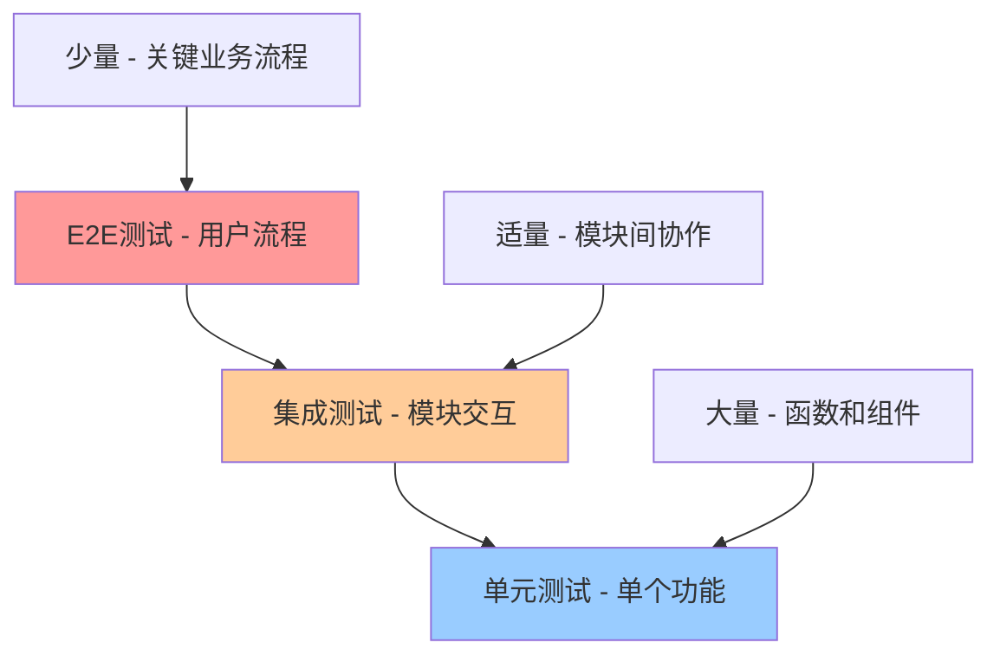
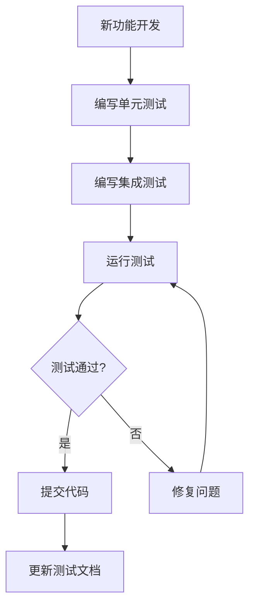
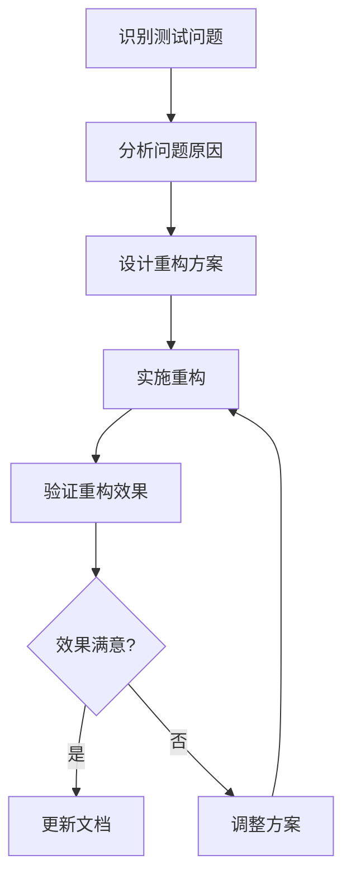

# Project-Z 完整测试指南

## 📋 目录

1. [测试架构概览](#测试架构概览)
2. [测试分类详解](#测试分类详解)
3. [测试配置说明](#测试配置说明)
4. [测试最佳实践](#测试最佳实践)
5. [测试运行指南](#测试运行指南)
6. [测试维护策略](#测试维护策略)
7. [故障排除指南](#故障排除指南)

## 🏗️ 测试架构概览

### 测试金字塔结构



### 测试目录结构

```
tests/
├── unit/                    # 单元测试 (70%)
│   ├── api/                # API层测试
│   ├── utils/              # 工具函数测试
│   ├── pages/              # 页面组件测试
│   ├── components/         # 组件测试
│   └── uni_modules/        # 插件模块测试
├── integration/            # 集成测试 (20%)
│   ├── api/                # API集成测试
│   ├── pages/              # 页面集成测试
│   └── components/         # 组件集成测试
├── app/                    # App平台测试 (5%)
│   └── pages/              # App页面测试
├── e2e/                    # 端到端测试 (5%)
├── setup/                  # 测试配置
│   ├── unit.setup.js       # 单元测试配置
│   ├── integration.setup.js # 集成测试配置
│   ├── app.setup.js        # App测试配置
│   ├── e2e.setup.js        # E2E测试配置
│   └── uniapp.setup.js     # UniApp环境模拟
└── jest.config.*.js        # Jest配置文件
```

## 🧪 测试分类详解

### 1. 单元测试 (Unit Tests)

**位置：** `tests/unit/`  
**占比：** 70%  
**目的：** 测试单个函数、方法或组件的功能

#### 1.1 API层测试 (`tests/unit/api/`)

**测试目标：** 业务逻辑和数据操作
**测试内容：**
- 数据验证和转换
- 业务规则实现
- 错误处理逻辑
- 数据库操作封装

**示例文件：**
- `aiApi.test.js` - AI功能测试
- `projectApi.test.js` - 项目管理测试
- `userApi.test.js` - 用户管理测试
- `chatApi.test.js` - 聊天功能测试

**测试策略：**
```javascript
// 真实源码测试 + 智能Mock
import aiApi from '@/api/aiApi.js'
import dbService from '@/utils/dbService.js'

describe('AI API 测试', () => {
  beforeEach(() => {
    // 只Mock外部依赖
    dbService.isInitialized = true
  })
  
  it('应该能够获取AI配置列表', async () => {
    const originalFindMany = dbService.findMany
    dbService.findMany = jest.fn().mockResolvedValue(mockConfigs)
    
    const result = await aiApi.getAIConfigList(1)
    
    expect(result).toEqual(mockConfigs)
    dbService.findMany = originalFindMany
  })
})
```

#### 1.2 工具函数测试 (`tests/unit/utils/`)

**测试目标：** 纯函数和工具方法
**测试内容：**
- 输入输出验证
- 边界条件处理
- 异常情况处理
- 性能表现

**示例文件：**
- `dateUtils.test.js` - 日期工具测试
- `cryptoUtils.test.js` - 加密工具测试
- `userStore.test.js` - 用户存储测试
- `dbService-simple.test.js` - 数据库服务测试

**测试策略：**
```javascript
// 纯函数测试，无Mock
import { formatDate, parseDate } from '@/utils/dateUtils.js'

describe('日期工具测试', () => {
  it('应该能够格式化日期', () => {
    const date = new Date('2024-01-15T10:00:00Z')
    const result = formatDate(date, 'YYYY-MM-DD')
    expect(result).toBe('2024-01-15')
  })
  
  it('应该能够处理无效日期', () => {
    expect(() => formatDate(null)).toThrow('无效的日期')
  })
})
```

#### 1.3 页面组件测试 (`tests/unit/pages/`)

**测试目标：** Vue页面组件
**测试内容：**
- 组件渲染
- 数据绑定
- 事件处理
- 生命周期

**示例文件：**
- `project-list.test.js` - 项目列表页测试

**测试策略：**
```javascript
// Vue组件测试
import { mount } from '@vue/test-utils'
import ProjectList from '@/pages/project/project-list.vue'

describe('项目列表页测试', () => {
  it('应该能够渲染项目列表', () => {
    const wrapper = mount(ProjectList, {
      props: { projects: mockProjects }
    })
    
    expect(wrapper.find('.project-list').exists()).toBe(true)
    expect(wrapper.findAll('.project-item')).toHaveLength(3)
  })
})
```

### 2. 集成测试 (Integration Tests)

**位置：** `tests/integration/`  
**占比：** 20%  
**目的：** 测试多个模块之间的交互

#### 2.1 API集成测试 (`tests/integration/api/`)

**测试目标：** API与数据库的集成
**测试内容：**
- 数据流完整性
- 事务处理
- 错误传播
- 性能表现

**示例文件：**
- `database.test.js` - 数据库集成测试
- `projectApi.test.js` - 项目API集成测试

**测试策略：**
```javascript
// 集成测试，使用真实数据库连接
describe('数据库集成测试', () => {
  let dbService
  
  beforeAll(async () => {
    dbService = new DatabaseService()
    await dbService.initDB()
  })
  
  afterAll(async () => {
    await dbService.close()
  })
  
  it('应该能够完成完整的CRUD操作', async () => {
    // 创建
    const project = await projectApi.createProject(mockProject)
    expect(project.id).toBeDefined()
    
    // 查询
    const found = await projectApi.getProject(project.id)
    expect(found.name).toBe(mockProject.name)
    
    // 更新
    const updated = await projectApi.updateProject(project.id, updates)
    expect(updated.name).toBe(updates.name)
    
    // 删除
    await projectApi.deleteProject(project.id)
    const deleted = await projectApi.getProject(project.id)
    expect(deleted).toBeNull()
  })
})
```

### 3. App平台测试 (App Tests)

**位置：** `tests/app/`  
**占比：** 5%  
**目的：** 测试App平台特定功能

#### 3.1 App页面测试 (`tests/app/pages/`)

**测试目标：** App平台页面功能
**测试内容：**
- 页面生命周期
- 平台特定API
- 用户交互
- 性能表现

**示例文件：**
- `index.test.js` - 首页App测试

**测试策略：**
```javascript
// App平台测试，模拟真实环境
describe('首页App测试', () => {
  let page
  
  beforeAll(async () => {
    // 模拟App环境
    page = await createAppPage('pages/index/index')
  })
  
  it('应该能够正常加载页面', async () => {
    await page.waitForSelector('.page-content')
    const title = await page.getText('.page-title')
    expect(title).toBe('指日可待')
  })
  
  it('应该能够处理用户交互', async () => {
    await page.tap('.btn-primary')
    await page.waitForSelector('.modal')
    expect(await page.isVisible('.modal')).toBe(true)
  })
})
```

### 4. 端到端测试 (E2E Tests)

**位置：** `tests/e2e/`  
**占比：** 5%  
**目的：** 测试完整的用户流程

#### 4.1 用户流程测试

**测试目标：** 关键业务流程
**测试内容：**
- 用户注册登录
- 项目创建管理
- 知识库操作
- 数据同步

**测试策略：**
```javascript
// E2E测试，模拟真实用户操作
describe('用户完整流程测试', () => {
  let page
  
  beforeAll(async () => {
    page = await createE2EPage()
  })
  
  it('应该能够完成项目创建到发布的完整流程', async () => {
    // 1. 登录
    await page.login('test@example.com', 'password')
    
    // 2. 创建项目
    await page.navigateTo('/pages/project/create')
    await page.fillForm({
      name: '测试项目',
      description: '这是一个测试项目'
    })
    await page.submit()
    
    // 3. 添加知识库
    await page.navigateTo('/pages/knowledge/add')
    await page.addKnowledge('项目文档', 'content')
    
    // 4. 发布项目
    await page.navigateTo('/pages/project/list')
    await page.publishProject('测试项目')
    
    // 验证结果
    expect(await page.isProjectPublished('测试项目')).toBe(true)
  })
})
```

## ⚙️ 测试配置说明

### 1. Jest配置文件

#### 1.1 单元测试配置 (`jest.config.unit.js`)

```javascript
module.exports = {
  displayName: 'Unit Tests',
  testMatch: ['<rootDir>/unit/**/*.test.[jt]s?(x)'],
  testEnvironment: 'node',
  setupFilesAfterEnv: [
    '<rootDir>/setup/unit.setup.js',
    '<rootDir>/setup/uniapp.setup.js'
  ],
  collectCoverageFrom: [
    '../api/**/*.js',
    '../utils/**/*.js',
    '!**/node_modules/**'
  ],
  coverageDirectory: '<rootDir>/coverage/unit',
  moduleNameMapper: {
    '^@/(.*)$': '<rootDir>/../$1'
  },
  transform: {
    '^.+\\.js$': 'babel-jest',
    '^.+\\.vue$': '@vue/vue3-jest'
  },
  testTimeout: 30000
}
```

#### 1.2 集成测试配置 (`jest.config.integration.js`)

```javascript
module.exports = {
  displayName: 'Integration Tests',
  testMatch: ['<rootDir>/integration/**/*.test.[jt]s?(x)'],
  testEnvironment: '@dcloudio/uni-automator/dist/environment.js',
  globalTeardown: '@dcloudio/uni-automator/dist/teardown.js',
  testEnvironmentOptions: {
    compile: true,
    "app-plus": {
      android: {
        appid: "__UNI__08418DF",
        package: "io.dcloud.UNI08418DF"
      }
    }
  },
  testTimeout: 20000
}
```

#### 1.3 App平台测试配置 (`jest.config.app.js`)

```javascript
module.exports = {
  displayName: 'App Tests',
  testMatch: ['<rootDir>/app/**/*.test.[jt]s?(x)'],
  testEnvironment: 'node',
  setupFilesAfterEnv: ['<rootDir>/setup/uniapp.setup.js'],
  globals: {
    'UNI_PLATFORM': process.env.UNI_PLATFORM || 'app-plus',
    'UNI_OS_NAME': process.env.UNI_OS_NAME || 'android'
  },
  testTimeout: 60000
}
```

### 2. 测试环境设置

#### 2.1 UniApp环境模拟 (`setup/uniapp.setup.js`)

```javascript
// 模拟uni全局对象
global.uni = {
  request: jest.fn(),
  getStorageSync: jest.fn(),
  setStorageSync: jest.fn(),
  showToast: jest.fn(),
  getSystemInfoSync: jest.fn(() => ({
    platform: 'android',
    system: 'Android 10'
  }))
}

// 模拟plus全局对象
global.plus = {
  ready: jest.fn(),
  sqlite: { openDatabase: jest.fn() }
}
```

#### 2.2 单元测试设置 (`setup/unit.setup.js`)

```javascript
// 单元测试全局设置
beforeEach(() => {
  jest.clearAllMocks()
  // 设置默认Mock
  global.console = {
    ...console,
    log: jest.fn(),
    error: jest.fn(),
    warn: jest.fn()
  }
})
```

## 🎯 测试最佳实践

### 1. 测试设计原则

#### 1.1 AAA模式 (Arrange-Act-Assert)

```javascript
describe('用户API测试', () => {
  it('应该能够创建用户', async () => {
    // Arrange - 准备测试数据
    const userData = {
      name: '测试用户',
      email: 'test@example.com'
    }
    const mockUserId = 123
    
    // Act - 执行被测试的方法
    const result = await userApi.createUser(userData)
    
    // Assert - 验证结果
    expect(result.id).toBe(mockUserId)
    expect(result.name).toBe(userData.name)
  })
})
```

#### 1.2 测试独立性

```javascript
describe('项目API测试', () => {
  beforeEach(() => {
    // 每个测试前清理状态
    jest.clearAllMocks()
    dbService.isInitialized = true
  })
  
  afterEach(() => {
    // 每个测试后恢复状态
    dbService.isInitialized = false
  })
})
```

#### 1.3 测试命名规范

```javascript
// 使用中文描述，格式：应该...当...时
describe('项目管理功能', () => {
  it('应该能够创建项目当提供有效数据时', () => {})
  it('应该抛出错误当项目名称为空时', () => {})
  it('应该能够更新项目当项目存在时', () => {})
})
```

### 2. Mock策略

#### 2.1 智能Mock原则

```javascript
// ✅ 好的做法：只Mock外部依赖
import aiApi from '@/api/aiApi.js'
import dbService from '@/utils/dbService.js'

// Mock外部依赖
dbService.findMany = jest.fn().mockResolvedValue(mockData)

// 测试真实业务逻辑
const result = await aiApi.getAIConfigList(1)
```

```javascript
// ❌ 不好的做法：Mock被测试的模块
jest.mock('@/api/aiApi.js')
const aiApi = require('@/api/aiApi.js')
```

#### 2.2 Mock恢复策略

```javascript
describe('API测试', () => {
  it('应该能够处理数据', async () => {
    // 保存原始方法
    const originalFindMany = dbService.findMany
    
    // 设置Mock
    dbService.findMany = jest.fn().mockResolvedValue(mockData)
    
    // 执行测试
    const result = await api.getData()
    
    // 恢复原始方法
    dbService.findMany = originalFindMany
    
    expect(result).toEqual(expectedData)
  })
})
```

### 3. 测试数据管理

#### 3.1 测试数据工厂

```javascript
// 创建测试数据工厂
const createMockProject = (overrides = {}) => ({
  id: 1,
  name: '测试项目',
  description: '这是一个测试项目',
  status: 'active',
  createdAt: '2024-01-15T10:00:00Z',
  ...overrides
})

// 使用工厂创建测试数据
const project = createMockProject({ name: '特殊项目' })
```

#### 3.2 测试数据隔离

```javascript
describe('项目API测试', () => {
  let testProjectId
  
  beforeEach(async () => {
    // 每个测试创建独立数据
    const project = await projectApi.createProject(createMockProject())
    testProjectId = project.id
  })
  
  afterEach(async () => {
    // 测试后清理数据
    if (testProjectId) {
      await projectApi.deleteProject(testProjectId)
    }
  })
})
```

## 🚀 测试运行指南

### 1. 基本命令

```bash
# 运行所有测试
npm test

# 运行特定类型测试
npm run test:unit          # 单元测试
npm run test:integration   # 集成测试
npm run test:app          # App平台测试
npm run test:e2e          # 端到端测试

# 运行特定文件测试
npm test -- tests/unit/api/aiApi.test.js

# 运行特定模式测试
npm test -- --testPathPattern=api

# 运行测试并生成覆盖率报告
npm run test:coverage

# 监视模式运行测试
npm run test:watch
```

### 2. 平台特定测试

```bash
# Android平台测试
npm run test:android

# iOS平台测试
npm run test:ios

# H5平台测试
npm run test:h5

# 微信小程序测试
npm run test:mp-weixin
```

### 3. 调试测试

```bash
# 运行单个测试文件并显示详细输出
npm test -- tests/unit/api/aiApi.test.js --verbose

# 运行测试并停在第一个失败处
npm test -- --bail

# 运行测试并显示覆盖率
npm test -- --coverage --coverageReporters=text
```

## 🔧 测试维护策略

### 1. 测试优先级管理

#### P0 - 核心功能测试（必须）
- **影响范围：** 应用基础功能，数据存储
- **测试频率：** 每次提交前必须通过
- **覆盖率目标：** 95%+

**包含模块：**
- 数据库服务 (dbService.js)
- 项目管理 API (projectApi.js)
- 用户存储 (userStore.js)
- 应用启动 (appStartup.js)

#### P1 - 业务功能测试（重要）
- **影响范围：** 主要业务功能，用户交互
- **测试频率：** 每日构建必须通过
- **覆盖率目标：** 85%+

**包含模块：**
- AI 聊天功能 (aiApi.js, chatApi.js)
- 知识库管理 (knowledgeApi.js)
- 收藏功能 (favoriteApi.js)

#### P2 - 页面功能测试（中等）
- **影响范围：** 用户界面，页面交互
- **测试频率：** 每周构建必须通过
- **覆盖率目标：** 70%+

#### P3 - 工具和组件测试（低优先级）
- **影响范围：** 辅助功能，第三方模块
- **测试频率：** 每月检查
- **覆盖率目标：** 60%+

### 2. 测试维护流程

#### 2.1 新功能测试



#### 2.2 测试重构



### 3. 测试质量监控

#### 3.1 覆盖率监控

```bash
# 生成覆盖率报告
npm run test:coverage

# 检查覆盖率阈值
npm test -- --coverage --coverageThreshold='{
  "global": {
    "branches": 80,
    "functions": 80,
    "lines": 80,
    "statements": 80
  }
}'
```

#### 3.2 性能监控

```javascript
// 性能测试示例
describe('性能测试', () => {
  it('API响应时间应该在合理范围内', async () => {
    const startTime = Date.now()
    await aiApi.getAIConfigList(1)
    const endTime = Date.now()
    
    expect(endTime - startTime).toBeLessThan(1000) // 1秒内
  })
})
```

## 🐛 故障排除指南

### 1. 常见问题及解决方案

#### 1.1 测试环境问题

**问题：** `plus.sqlite 不可用，请确保在App环境中运行`

**解决方案：**
```javascript
// 在测试前设置数据库状态
beforeEach(() => {
  dbService.isInitialized = true
})
```

#### 1.2 模块导入问题

**问题：** `Cannot resolve module '@/api/aiApi.js'`

**解决方案：**
```javascript
// 检查moduleNameMapper配置
moduleNameMapper: {
  '^@/(.*)$': '<rootDir>/../$1'
}
```

#### 1.3 异步测试问题

**问题：** 异步测试超时或失败

**解决方案：**
```javascript
// 使用正确的异步测试模式
it('应该能够处理异步操作', async () => {
  const result = await asyncFunction()
  expect(result).toBeDefined()
}, 10000) // 设置超时时间
```

#### 1.4 Mock问题

**问题：** Mock不生效或返回值错误

**解决方案：**
```javascript
// 确保Mock在正确的位置
beforeEach(() => {
  jest.clearAllMocks()
  // 重新设置Mock
  mockFunction.mockResolvedValue(expectedValue)
})
```

### 2. 调试技巧

#### 2.1 测试调试

```bash
# 运行单个测试并显示详细输出
npm test -- tests/unit/api/aiApi.test.js --verbose --no-coverage

# 使用Node.js调试器
node --inspect-brk node_modules/.bin/jest tests/unit/api/aiApi.test.js
```

#### 2.2 日志调试

```javascript
// 在测试中添加调试日志
it('应该能够处理数据', async () => {
  console.log('开始测试，输入数据：', inputData)
  
  const result = await functionUnderTest(inputData)
  
  console.log('测试结果：', result)
  expect(result).toBeDefined()
})
```

### 3. 性能优化

#### 3.1 测试执行优化

```javascript
// 使用并行测试
module.exports = {
  maxWorkers: '50%', // 使用50%的CPU核心
  testTimeout: 10000 // 设置合理的超时时间
}
```

#### 3.2 内存优化

```javascript
// 及时清理测试数据
afterEach(() => {
  // 清理全局状态
  jest.clearAllMocks()
  // 清理测试数据
  cleanupTestData()
})
```

## 📊 测试指标和报告

### 1. 测试覆盖率

```bash
# 生成详细覆盖率报告
npm run test:coverage

# 覆盖率报告位置
tests/coverage/
├── lcov-report/     # HTML报告
├── lcov.info        # LCOV格式
└── clover.xml       # Clover格式
```

### 2. 测试性能指标

- **测试执行时间：** < 5分钟
- **测试通过率：** 100%
- **覆盖率目标：** 80%+
- **核心模块覆盖率：** 95%+

### 3. 测试报告

```bash
# 生成测试报告
npm test -- --reporters=default --reporters=jest-html-reporters

# 报告位置
tests/reports/
├── test-results.html
└── coverage-report.html
```

## 🎉 总结

本测试指南提供了Project-Z项目的完整测试解决方案，包括：

1. **完整的测试架构** - 从单元测试到E2E测试的完整体系
2. **详细的配置说明** - 各种测试环境的配置方法
3. **最佳实践指导** - 测试设计、Mock策略、数据管理
4. **运行和维护指南** - 如何运行、调试和维护测试
5. **故障排除方案** - 常见问题的解决方案

通过遵循本指南，可以建立稳定、高效、可维护的测试体系，确保项目质量和开发效率。

---

**文档版本：** v1.0  
**创建时间：** 2024-01-15  
**维护者：** AI Assistant  
**状态：** 已完成 ✅
