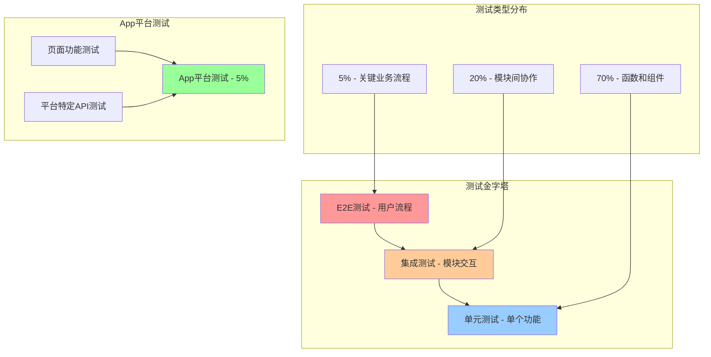
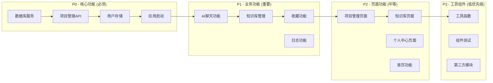
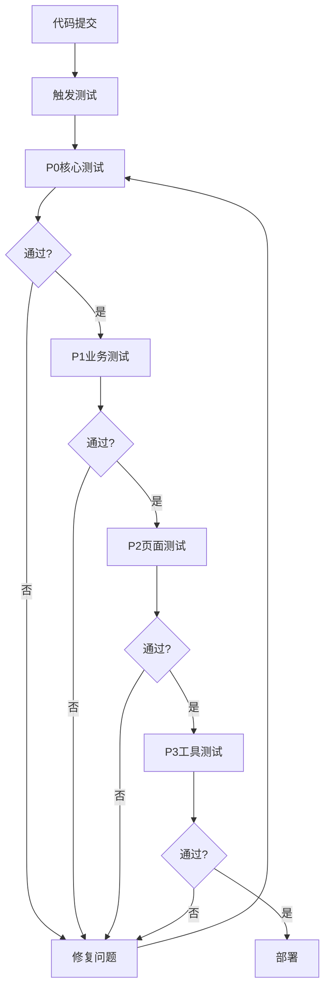
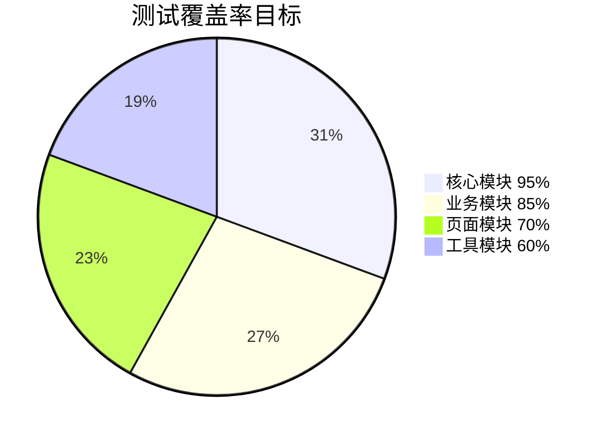
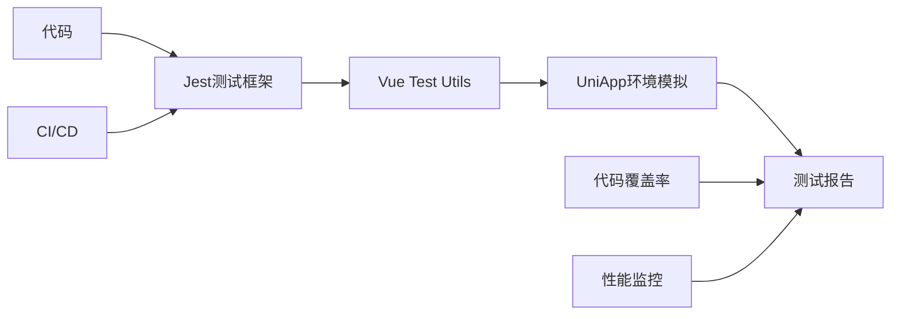

# 测试架构概览

## 🏗️ 测试架构图

## 📁 目录结构详解

```mermaid
graph TD
    A[tests/] --> B[unit/ - 单元测试 70%]
    A --> C[integration/ - 集成测试 20%]
    A --> D[app/ - App平台测试 5%]
    A --> E[e2e/ - 端到端测试 5%]
    A --> F[setup/ - 测试配置]
    A --> G[jest.config.*.js - Jest配置]
    
    B --> B1[api/ - API层测试]
    B --> B2[utils/ - 工具函数测试]
    B --> B3[pages/ - 页面组件测试]
    B --> B4[components/ - 组件测试]
    B --> B5[uni_modules/ - 插件模块测试]
    
    C --> C1[api/ - API集成测试]
    C --> C2[pages/ - 页面集成测试]
    C --> C3[components/ - 组件集成测试]
    
    D --> D1[pages/ - App页面测试]
    
    E --> E1[用户流程测试]
    
    F --> F1[unit.setup.js - 单元测试设置]
    F --> F2[integration.setup.js - 集成测试设置]
    F --> F3[app.setup.js - App测试设置]
    F --> F4[e2e.setup.js - E2E测试设置]
    F --> F5[uniapp.setup.js - UniApp环境模拟]
```

## 🎯 测试优先级矩阵

## 🔄 测试执行流程

## 📊 测试覆盖率目标

## 🚀 测试执行时间目标

```mermaid
gantt
    title 测试执行时间分配
    dateFormat X
    axisFormat %M分钟
    
    section 单元测试
    快速执行 :done, unit, 0, 2
    
    section 集成测试
    中等执行 :done, integration, 2, 4
    
    section App测试
    平台测试 :done, app, 4, 5
    
    section E2E测试
    完整流程 :done, e2e, 5, 6
```

## 🔧 测试工具链

## 📈 测试质量指标

### 覆盖率指标
- **整体覆盖率：** 80%+
- **核心模块覆盖率：** 95%+
- **业务模块覆盖率：** 85%+
- **页面模块覆盖率：** 70%+

### 性能指标
- **测试执行时间：** < 5分钟
- **测试通过率：** 100%
- **测试维护成本：** 低
- **测试稳定性：** 高

### 质量指标
- **测试独立性：** 每个测试独立运行
- **测试可重复性：** 结果一致
- **测试可维护性：** 易于修改和扩展
- **测试可读性：** 清晰的测试描述

## 🎯 测试策略

### 1. 测试分层策略
- **单元测试：** 测试单个函数和方法
- **集成测试：** 测试模块间交互
- **App测试：** 测试平台特定功能
- **E2E测试：** 测试完整用户流程

### 2. Mock策略
- **智能Mock：** 只Mock外部依赖
- **真实测试：** 测试真实业务逻辑
- **独立测试：** 保持测试独立性

### 3. 数据管理策略
- **测试数据工厂：** 统一创建测试数据
- **数据隔离：** 每个测试使用独立数据
- **数据清理：** 测试后自动清理

## 📚 相关文档

- [完整测试指南](COMPLETE-TESTING-GUIDE.md) - 详细的测试文档
- [快速参考](QUICK-REFERENCE.md) - 常用命令和配置
- [测试目录结构说明](README.md) - 目录组织说明

---

**文档版本：** v1.0  
**创建时间：** 2024-01-15  
**维护者：** AI Assistant  
**状态：** 已完成 ✅
